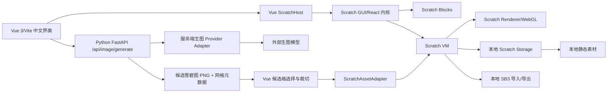

# Scratch 本地图形化创作页与 AI 生图功能实施计划

**Project Path**：`D:/ywj/AI-Scratch-web/`

## Goal

构建一个类官方 Scratch 的本地化网页编辑器：用户可以在 Scratch 舞台和积木编辑器中创作，并通过 AI 生图面板选择画布尺寸、画面风格和导入目标。每次生成默认得到一张 2×2 的候选雪碧图（候选拼图，不作为动画帧），用户点击其中一格后，将该格实时导入为舞台背景或角色造型。

本期的核心验收结果：

1. 网页可以离线加载 Scratch 编辑器、默认积木、默认素材和中文界面；除调用生图后端外，不请求 Scratch 官方 CDN、素材云端或平台业务接口。
2. 用户可以选择提示词、尺寸/比例、风格和目标类型（背景/角色），提交候选雪碧图生成请求。
3. 生图完成后，页面展示候选网格；用户选择一格后，图片数据直接变成当前 Scratch 项目的本地资源：背景会成为舞台 backdrop，角色会创建为新 sprite 和 costume。
4. 生成的项目可以通过标准 SB3 下载，重新加载后图片仍然存在，不依赖生成服务的图片 URL。
5. 生图模型的 API Key、模型地址和供应商请求细节只存在 Python 后端配置中，前端 bundle、网络请求和浏览器存储中都没有密钥。

## Architecture



### 责任边界

- Scratch GUI、Scratch Blocks、Scratch VM、Scratch Renderer 负责积木编辑、线程运行、舞台渲染和输入事件，不新增积木解释器。
- `SpriteSheetSelector.vue` 负责展示候选雪碧图、按网格裁切用户选中的一格并产出 Blob；它不直接修改 VM。
- `ScratchAssetAdapter` 是唯一的 Scratch 生成图片导入入口，负责把选中的 Blob 转换成 costume 或 backdrop；UI 不直接修改 VM 的内部 targets 数据。
- `ImageGenerationService` 是后端唯一的模型调用入口，负责参数校验、供应商适配、超时、内容类型校验和图片数据归一化。
- 生图 Provider 固定遵循 `$sui-xiang-imagegen` 的 OpenAI 兼容契约：`https://sui-xiang.com/v1`、模型 `gpt-image-2.5-sunburst`、`client.images.generate`。密钥只由后端读取服务端 secret，技能脚本不进入前端构建。
- 前端只知道本地 `/api/image/generate` 契约，不知道供应商名称、模型 URL 或 API Key。
- 生成结果默认只存入当前 VM 和用户下载的 SB3；后端不提供长期图片托管和公开图片 URL。

## Tech Stack

- 前端：Vue 3、Vite、Composition API、Scratch GUI、Scratch VM、Scratch Blocks、Scratch Renderer、Scratch Storage。Scratch GUI 本身仍是 React 内核，由 Vue 宿主挂载到专用 DOM 容器，不重写 Scratch 编辑器。
- 后端：Python 3.11+ / Go、FastAPI / Go 标准库、Uvicorn、Pydantic、httpx、Pillow。
- 本地静态资源：由前端同源静态目录提供 Scratch 默认素材、中文 locale、字体、图标和竞品页面可复用的 UI 素材；生产构建禁止引用 `scratch.mit.edu`、`assets.scratch.mit.edu` 等远程地址。
- 生图接口：支持 Agnes `agnes-image-2.5-flash` 与 Sui Xiang `gpt-image-2.5-sunburst`；Provider Adapter 只保留供应商请求封装和服务端图片下载，不在代码或前端构建中写入密钥。
- 测试：Python `pytest`/`httpx` 测试后端，Vitest + Vue Test Utils 测试前端适配器和状态，Playwright 做浏览器集成与离线网络审计。

## Baseline / Authority Refs

- 本地竞品页面：[图形化编程-自由创作区.html](D:/ywj/各种参考文档/Scratch网页竞品/图形化编程-自由创作区.html:1026)。其中的 `scratchConfig`、VM 初始化、默认项目加载和平台保存流程是定制 Scratch GUI 的参考。
- 本地项目加载接口：[common.js.下载](D:/ywj/各种参考文档/Scratch网页竞品/图形化编程-自由创作区_files/common.js.下载:92)。其中的作品元数据请求仅作为业务层参考，不迁移同步 AJAX 和平台作品接口。
- 本地素材注入：[material-center.js.下载](D:/ywj/各种参考文档/Scratch网页竞品/图形化编程-自由创作区_files/material-center.js.下载:6)。其中的素材库 hook 证明素材扩展应通过 GUI/VM 的公开入口完成。
- 生图模型契约：[$sui-xiang-imagegen/SKILL.md](C:/Users/Think/.agents/skills/sui-xiang-imagegen/SKILL.md) 和其 `scripts/generate_image.py`。固定 base URL 为 `https://sui-xiang.com/v1`，模型更新为 `gpt-image-2.5-sunburst`，调用方式为 OpenAI 兼容的 `client.images.generate`；本项目将该调用放在后端，不把技能脚本或密钥打进前端。
- UI 素材来源：[图形化编程-自由创作区_files](D:/ywj/各种参考文档/Scratch网页竞品/图形化编程-自由创作区_files/)，优先复用其中的 `scratch_logo.svg`、`scratch.css`、`index.css` 和所需 SVG 图标，并复制到新项目的本地静态目录。
- 线上参考：[scratchcn.pages.dev](https://scratchcn.pages.dev/)、[gui.js](https://scratchcn.pages.dev/gui.js)。线上页面确认采用 React Scratch GUI、Hash 项目加载、Scratch VM、Storage 和 WebGL Renderer；本项目只复用其 Scratch 引擎能力，业务界面改由 Vue 实现。
- 现状：`D:/ywj/AI-Scratch-web/` 当前为空目录；以下文件 map 是拟建工程边界，不宣称这些文件已经存在。

## Requirement Ready Check

- Requirement source refs：本次用户需求（类官方 Scratch、本地化、AI 生图、背景/角色导入、Python 后端、前端不存 Key）。
- Goals and scope refs：本计划的 Goal 和“非目标”章节。
- User/scenario refs：用户选择尺寸、风格、目标类型后生成，并实时放入当前舞台。
- Acceptance refs：Goal 中 1-5 条验收结果，以及 Verification 章节。
- 非阻塞假设：前端采用 Vue 3/Vite 作为页面宿主，Scratch GUI React 内核挂载在 `ScratchHost.vue` 的 DOM 容器中；后端采用 FastAPI；Sui Xiang 的固定模型契约不做供应商切换抽象；生成图片默认随当前项目和 SB3 保存，不做服务端长期存储；候选雪碧图第一版固定为 2×2。
- Open blocker questions：无阻塞问题。供应商、模型和最终风格选项不影响接口与适配器边界，可由部署配置决定。
- Decision：ready

## Compatibility Boundary

- 保留 Scratch 3 项目格式和 `vm.loadProject`/`vm.saveProjectSb3` 兼容性；不能用自定义 JSON 替代 SB3 作为唯一项目格式。
- 保留标准 Scratch 舞台坐标、积木 opcode、事件线程、广播、克隆、声音和扩展机制。
- 生成背景必须作为 stage 的 costume/backdrop 资源导入；生成角色必须作为 sprite 的 costume 导入，不能只把图片覆盖在 HTML 舞台上，否则作品保存和运行时会丢失。
- 生成结果必须转换为本地 Blob/ArrayBuffer 并由 VM 计算资源描述；Scratch 项目中不能保存第三方图片 URL。
- 本地模式禁止云变量、社区分享、官方 Backpack、在线素材库和遥测请求；“生成图片”这一条外部网络链路由 Python 后端统一代理。
- 第一版不承诺兼容任意 Scratch 扩展的私有资源协议；启用扩展时必须确认其资源也能随 SB3 或本地静态目录解析。

## TDD Route

- Mode：off
- Decision：skipped
- Strict authority：not applicable；用户要求先写计划，未要求严格 TDD。
- Test posture：实现各阶段采用契约测试、Provider mock、前端状态测试和浏览器集成回归。
- Reason：当前交付物是计划文档，不执行代码变更；未来实现按风险在接口和资产导入边界优先测试。
- Verification：以本计划 Verification 章节中的命令和手工验收为准。

## Proposed File Map

```text
AI-Scratch-web/
├─ frontend/
│  ├─ src/app/App.vue                         # 页面布局和 Scratch/AI 面板编排
│  ├─ src/scratch/ScratchHost.vue             # Vue 宿主 DOM、GUI 挂载和生命周期
│  ├─ src/scratch/scratch-gui-bridge.ts       # Vue 与 React Scratch GUI/VM 的桥接
│  ├─ src/scratch/local-storage.ts            # 本地项目/素材资源适配
│  ├─ src/scratch/asset-adapter.ts            # Blob -> backdrop/sprite costume 导入
│  ├─ src/ai/ImageGenerationPanel.vue         # 中文参数面板、状态和结果预览
│  ├─ src/ai/SpriteSheetSelector.vue          # 候选雪碧图网格、单格预览和裁切
│  ├─ src/ai/image-generation-api.ts          # /api/image/generate 客户端
│  ├─ src/ai/image-generation-types.ts        # 请求、响应、错误契约
│  ├─ src/locales/zh-cn.json                  # 页面和新增控件中文文案
│  ├─ src/styles/local-ui.css                 # 基于竞品素材的本地化 UI 样式
│  ├─ public/assets/ui/                       # 从竞品 _files 复制的 logo、图标和 CSS 素材
│  ├─ public/assets/scratch/                  # 本地 Scratch 默认资源和字体
│  └─ tests/                                  # 前端适配器、状态和网络审计测试
├─ backend/
│  ├─ app/main.py                             # FastAPI 应用和静态/健康路由
│  ├─ app/config.py                           # 环境变量配置和允许值
│  ├─ app/schemas/image_generation.py         # Pydantic 请求/响应模型
│  ├─ app/routes/image_generation.py          # POST /api/image/generate
│  ├─ app/services/image_generation.py        # 超时、下载、校验、归一化
│  ├─ app/providers/base.py                   # Provider Adapter 协议
│  ├─ app/providers/sui_xiang_provider.py     # Sui Xiang gpt-image-2.5-sunburst 实现
│  ├─ app/prompts.py                          # 尺寸/风格/目标/2×2 雪碧图提示词组装
│  └─ tests/                                  # API、参数、安全和 Provider mock 测试
└─ docs/
   ├─ architecture.md                         # 稳定架构与接口说明
   └─ deployment.md                           # 本地启动、环境变量和离线资源清单
```

## Implementation Tasks

### Task 1：建立本地 Scratch 编辑器基线

**Files**：`frontend/src/scratch/ScratchHost.vue`、`frontend/src/scratch/scratch-gui-bridge.ts`、`frontend/src/scratch/local-storage.ts`、`frontend/public/assets/scratch/`。

**Why**：先证明类官方编辑器可以在无云端素材和无 AI 的情况下独立运行，避免把生图问题与 Scratch 初始化问题混在一起。

**Change Necessity**：现有竞品是 HTML 快照，不能作为可维护工程；必须建立本地构建入口、VM/Renderer/Storage 连接和本地静态资源边界。

**Steps**：

1. 创建 Vite Vue 3 工程并锁定 Scratch 相关依赖版本。
2. 在 `ScratchHost.vue` 中创建稳定的 DOM 容器，由 `scratch-gui-bridge.ts` 挂载 React Scratch GUI，创建 VM，连接本地 Storage 和 Renderer。
3. 将默认项目、默认素材、中文 locale 和字体改为同源静态资源。
4. 隐藏云端、Backpack、社区、遥测和外链入口，保留新建、打开 SB3、保存 SB3、绿旗、停止和全屏。

**Verification**：`npm run build`；使用 Playwright 在断网拦截模式打开页面，确认舞台、积木分类、绿旗和停止按钮可用，网络日志中除本地资源外没有外部请求。

### Task 2：定义并实现 Python 生图接口

**Files**：`backend/app/config.py`、`backend/app/schemas/image_generation.py`、`backend/app/routes/image_generation.py`、`backend/app/services/image_generation.py`、`backend/app/providers/base.py`、`backend/app/providers/sui_xiang_provider.py`、`backend/app/prompts.py`。

**Why**：为前端提供稳定的本地接口，并把 API Key、供应商协议和远程图片下载隔离在后端。

**Change Necessity**：浏览器直连模型会暴露密钥且无法统一处理供应商返回的 URL、尺寸和 MIME 类型；必须由 Python 服务代理。

**API contract**：

```text
POST /api/image/generate

Request JSON:
{
  "prompt": "夜晚的森林小屋",
  "style": "cartoon",
  "width": 480,
  "height": 360,
  "target": "backdrop",
  "sheet_layout": "2x2"
}

Success JSON:
{
  "request_id": "...",
  "mime_type": "image/png",
  "sheet_width": 1024,
  "sheet_height": 1024,
  "sheet_layout": {"columns": 2, "rows": 2},
  "image_base64": "...",
  "target": "backdrop",
  "requested_canvas": {"width": 480, "height": 360}
}
```

**Steps**：

1. 为 `prompt` 长度、尺寸白名单、目标类型、风格枚举和 `2x2` 雪碧图布局编写 Pydantic 校验。
2. 在 `prompts.py` 中将用户提示词、尺寸/比例、风格和目标组装成固定的候选雪碧图提示词：2×2 等尺寸网格、每格一个独立候选、统一风格、无文字和无网格线；角色目标追加“尽量使用干净/透明背景”的要求。
3. 在 `sui_xiang_provider.py` 中严格使用 `base_url="https://sui-xiang.com/v1"`、`model="gpt-image-2.5-sunburst"` 和 `client.images.generate(model=..., prompt=...)`；API Key 只从后端 secret 读取，不复用为前端配置。
4. 由于技能脚本的固定调用只传模型和 prompt，用户选择的画布尺寸通过提示词约束，并由前端对候选格执行目标尺寸裁切/缩放；接口响应同时保留模型实际雪碧图尺寸。
5. 对模型返回的 URL 由后端立即下载；只接受图片 MIME，限制重定向、大小和超时，然后编码为响应中的图片数据。
6. 统一返回 `INVALID_REQUEST`、`TIMEOUT`、`PROVIDER_ERROR`、`INVALID_IMAGE` 等错误码，不返回供应商原始密钥或未校验 URL。

**Verification**：`pytest backend/tests -q`；使用 mock provider 验证成功、超时、非图片响应、超大图片、非法尺寸和缺失 `SUI_XIANG_API_KEY` 启动失败；检查前端构建产物和浏览器请求中不存在 `SUI_XIANG_API_KEY`。

### Task 3：实现 AI 参数面板和中文本地化

**Files**：`frontend/src/ai/ImageGenerationPanel.vue`、`frontend/src/ai/SpriteSheetSelector.vue`、`frontend/src/ai/image-generation-api.ts`、`frontend/src/ai/image-generation-types.ts`、`frontend/src/locales/zh-cn.json`、`frontend/src/app/App.vue`。

**Why**：让用户明确控制画布规格、风格和导入位置，并能看到生成中的状态和失败原因。

**Steps**：

1. 提供提示词输入、尺寸/比例选择、风格选择、背景/角色分段控件和生成按钮；默认请求 `sheet_layout=2x2`。
2. 提供 Scratch 舞台推荐尺寸 `480×360`，并允许受白名单限制的其他横向、方形和竖向尺寸；这些尺寸既用于服务端提示词，也用于前端候选格裁切。
3. 生成完成后在 `SpriteSheetSelector.vue` 中显示 2×2 候选网格、单格预览和“使用此结果”操作；用户必须先选中候选格，再导入舞台。
4. 角色目标在提示词中要求干净/透明背景；由于模型固定调用没有独立 alpha 参数，若返回图片仍有背景，结果预览中必须明确提示，不伪造透明效果。
5. 生成期间禁用重复提交，显示进度状态；支持取消当前浏览器请求、重试和错误提示。
6. 所有按钮、表单、错误、空状态和 Scratch GUI 扩展文案使用中文，不加载远程语言包。

**Verification**：`npm run test:unit -- image-generation`；Playwright mock `/api/image/generate`，验证 2×2 候选网格、单格选择、参数映射、加载/失败/重试状态和中文文案；检查 1280px 与 390px 视口无控件重叠。

### Task 4：把生成图片实时导入 Scratch 舞台

**Files**：`frontend/src/scratch/asset-adapter.ts`、`frontend/src/ai/ImageGenerationPanel.vue`、`frontend/src/ai/SpriteSheetSelector.vue`、`frontend/src/scratch/ScratchHost.vue`、`frontend/src/scratch/scratch-gui-bridge.ts`。

**Why**：这是功能的核心闭环，图片必须成为 Scratch 项目资源，而不是只显示在网页覆盖层。

**Steps**：

1. 将 `image_base64` 转换为 Blob，并通过浏览器 `createImageBitmap` 校验雪碧图实际尺寸和解码结果。
2. 按响应中的 `columns=2`、`rows=2` 从雪碧图裁出用户选中的单元格，按用户选择的 canvas 尺寸裁切/缩放，并生成新的本地 Blob；不把 2×2 整图当作 Scratch 角色或动画帧导入。
3. 通过目标版本 Scratch VM 的公开资源 API 导入 backdrop；导入后选中新的舞台背景并刷新舞台。
4. 通过公开资源 API 创建新 sprite 和 costume；设置可读名称、初始位置、方向和合理显示大小，并选中新角色。
5. 让导入操作在用户确认候选格后立即执行；成功后在 AI 面板显示缩略图、尺寸和目标，失败时不留下半成品 target 或 asset。
6. 确认导入的图片能随 `vm.saveProjectSb3()` 进入 SB3，而不是保留 data URL 或外链。

**Verification**：使用固定 2×2 PNG fixture 验证四个候选格坐标和边界；分别导入背景和角色；保存 SB3 后解压检查 `project.json` 和裁切后的图片资源；重新加载 SB3，确认背景、角色、尺寸和积木运行结果一致。

### Task 5：本地保存、离线资源和可恢复性

**Files**：`frontend/src/scratch/local-storage.ts`、`frontend/public/assets/scratch/`、`frontend/public/assets/ui/`、`frontend/src/styles/local-ui.css`、`docs/deployment.md`。

**Why**：满足“素材不依赖云端”，并让生成图片成为用户自己的项目资源。

**Steps**：

1. 将 Scratch 默认素材、字体、图标、locale 和初始项目放入本地静态目录。
2. 从 `D:/ywj/各种参考文档/Scratch网页竞品/图形化编程-自由创作区_files/` 复制并整理 `scratch_logo.svg`、`scratch.css`、`index.css` 和实际使用的 SVG 图标到 `frontend/public/assets/ui/`，通过 `local-ui.css` 统一覆盖页面样式；不继续引用快照目录中的相对路径。
3. 配置 Storage 的 project/asset host 为同源路径，移除官方默认 CDN 地址。
4. 保留标准 SB3 打开和下载；下载文件必须包含用户选中的裁切图片。
5. 将部署说明写明后端唯一外部链路是 Sui Xiang 模型供应商，前端唯一动态网络请求是本地生图 API。
6. 为资源加载失败提供中文错误页，避免静默显示空舞台。

**Verification**：清空浏览器缓存后断网打开；加载本地默认项目、编辑积木、显示本地竞品 UI 素材、生成 2×2 结果 fixture、选择单格、保存并重新加载 SB3；网络审计确认没有第三方素材请求。

### Task 6：安全、质量和发布验收

**Files**：`backend/tests/`、`frontend/tests/`、`docs/architecture.md`、`docs/deployment.md`。

**Why**：确保模型密钥、远程图片、项目资产和浏览器状态之间的边界可审计。

**Steps**：

1. 增加后端请求大小、提示词长度、并发数和超时限制。
2. 对 Sui Xiang 返回的图片执行 MIME、尺寸、文件大小和解码校验，并验证响应确实可按 2×2 网格裁切。
3. 对前端产物执行 API Key 扫描和外链扫描；确认只出现本地静态资源和 `/api/image/generate`。
4. 对浏览器生成流程执行成功、失败、取消、重复点击、候选格选择、背景导入、角色导入和 SB3 重新加载场景。
5. 记录 Sui Xiang 的固定模型契约、尺寸提示词映射和透明背景限制，避免把未支持的 provider 参数误传给接口。

**Verification commands**：

```text
python -m pytest backend/tests -q
npm run test:unit
npm run build
npx playwright test
```

**Release acceptance**：无服务端 Key 时后端启动检查明确失败但不泄露值；有 Key 时可完成一次真实 Sui Xiang 生图 smoke test；前端 bundle 不含 Key；断网时编辑和本地 SB3 读写可用；2×2 候选图可选择单格并作为背景和角色正常运行。

## Change Necessity

- User-visible need：在 Scratch 创作过程中把 AI 生成的候选雪碧图单格直接变成可编程的背景或角色。
- No-change option：仅在页面上叠加 `` 或使用远程图片 URL，无法被 Scratch VM 编程、保存到 SB3，也不满足本地素材要求。
- Why code change is necessary：需要新增 Vue AI 面板、候选格裁切器、后端 Sui Xiang 代理接口、本地 UI 素材目录和 VM 资产导入适配器。
- Minimum boundary：Scratch GUI 宿主、ImageGenerationPanel、SpriteSheetSelector、ScratchAssetAdapter、FastAPI image generation route；不改 Scratch VM 核心解释器。
- Decision：code-change（本次只记录计划，不执行代码变更）。

## Existence Check

- Proposed new surface：`SpriteSheetSelector` 和 `ScratchAssetAdapter`。
- Existing owner / reuse candidate：Scratch VM 的公开 asset/costume/backdrop API。
- Why existing surface is insufficient：Scratch GUI 没有候选雪碧图选择和单格裁切业务；需要把 AI 响应的 Blob、网格尺寸和目标类型统一转换，并处理失败回滚；不能让面板直接操作 VM 内部结构。
- Creation proof：选择器只负责网格展示与裁切，适配器只负责 VM 导入，两者可用 fixture 和 SB3 解压检查独立验证。
- Entropy / retirement impact：不新增 Scratch 运行时分支；未来若 GUI 提供统一 Blob 导入和裁切服务，可将面板改为调用该服务并删除适配器内部重复转换。
- Decision：add-with-proof。

## Architecture Integrity Lens

- Invariant：Scratch VM 是项目运行和资源持久化的唯一事实来源；AI 图片必须进入 VM。
- Canonical owner / contract：后端拥有 Sui Xiang 模型调用契约，`SpriteSheetSelector` 拥有候选格裁切契约，前端 `ScratchAssetAdapter` 拥有图片到 Scratch 资源的转换契约。
- Responsibility overlap：AI 面板不得负责模型协议、图片下载或 VM 内部 target 修改；选择器不得直接创建 sprite/backdrop。
- Higher-level simplification：统一使用一个 `/api/image/generate`、一个候选选择器和一个导入适配器，背景/角色只由 `target` 参数分派。
- Retirement / falsifier：若某个 Scratch GUI 版本提供稳定的官方 Blob 导入服务，则以集成测试证明等价后，删除适配器中的重复转换逻辑。
- Verdict：架构边界清晰，可进入实现规划。

## Plan-Time Complexity Check

- Target files：Scratch 宿主、AI 面板、候选雪碧图选择器、资产适配器、FastAPI 路由、Sui Xiang Provider 和本地 UI 资源。
- Existing size / shape signals：当前只有竞品快照，没有现成工程文件；不应把新业务逻辑继续塞入快照 HTML 或压缩 bundle。
- Owner fit：Scratch 运行逻辑留在 Scratch 包；AI 请求留在后端 service/provider；UI 状态留在 AI 面板。
- Add-in-place risk：直接修改官方 bundle 会导致无法升级和无法测试，因此使用源码工程和独立适配器。
- Better file boundary：按宿主、API、服务、供应商、资产导入和 UI 拆分。
- Recommendation：add owner files in a new project boundary; do not edit the saved competitor snapshot。
- Budget result：within-budget。

## Plan Pressure Test

- Owner / contract / retirement：模型、图片导入和 Scratch 运行时分别有唯一 owner，Provider Adapter 有替换边界。
- Architecture integrity / higher-level path：不新增解释器、不新增云端资源服务，复用 Scratch 官方运行链路。
- Verification scope：覆盖离线加载、API 契约、真实图片解码、背景/角色导入、SB3 持久化和密钥扫描。
- Task executability：每个任务均指定拟建文件、边界和验证命令。
- Pressure result：proceed。

## Execution Readiness View

- Intent Lock：类官方 Scratch 本地编辑器 + Python Sui Xiang 生图代理 + 候选雪碧图单格导入背景/角色。
- Scope Fence：不实现社区、云变量、在线素材库、长期图片托管和自研积木解释器。
- Baseline Lock：以本地竞品快照和线上 Scratch GUI 行为为参考，不复制平台账号和 OSS 保存逻辑。
- Approved Behavior：尺寸/风格/目标可选；生成完成展示 2×2 候选图，用户选中单格后立即导入当前项目；SB3 包含裁切图片；前端不持有 Key。
- Owner / Contract Constraints：后端只暴露本地生图契约；前端只调用该契约；VM 只通过公开资源 API 接收资源。
- Compatibility Boundary：标准 Scratch 3 SB3、480×360 舞台坐标和运行时行为保持兼容。
- Retirement Boundary：Provider-specific 代码只能位于 provider 目录；不在 UI 中保留供应商分支。
- Task Batches：Scratch 基线 -> Sui Xiang Python API -> AI 面板与候选选择 -> 资源导入 -> 本地 UI/离线保存 -> 质量验收。
- Test Obligations：每批均有 focused test；最终必须完成 Playwright 离线和 SB3 重载验收。
- Review Gates：API 契约审查、资源导入审查、密钥/外链审查、真实浏览器验收。
- Drift / Rewind Rules：若 Scratch VM 版本没有稳定的公开 backdrop/sprite 导入 API，先暂停 Task 4，记录实际 API，再调整适配器，不直接写内部对象。
- Evidence Required Before Completion：测试命令结果、浏览器网络审计、背景/角色截图或录像、SB3 解压资源清单和前端密钥扫描结果。
- Advisory Boundary：此视图是实施前的执行准备，不替代运行时验收。

## Execution Route

- Decision：inline
- Evidence：任务之间有依赖关系，且当前只需要单一计划文档；不拆分子任务。
- Fallback：后续若前后端可以完全独立开发，再按任务边界分批执行。
- User confirmation required：no

## Risks and Rollback

- Sui Xiang 模型输出尺寸受限：尺寸通过雪碧图提示词约束，后端保留“请求尺寸/实际尺寸”元数据，前端明确显示实际结果，不静默拉伸。
- 角色图没有透明通道：保持原图导入并显示提示；不在第一版偷偷引入不可控的第三方抠图服务。
- 生成接口慢或失败：前端可取消/重试，后端设置超时；失败不改变当前 Scratch 项目。
- 图片过大：后端限制响应大小，前端限制解码尺寸，超限时拒绝导入。
- 旧竞品快照误被当作源代码：实施时只从新工程构建，不直接编辑压缩 bundle 或保存的 HTML。
- 回滚：每个任务以独立提交完成；若资产导入有问题，可回滚 AI 面板和适配器而保留本地 Scratch 基线。

## Retirement

- 不迁移本地竞品的同步作品查询、账号 token、OSS 上传、固定 AES 加密和平台发布接口。
- 不保留官方 Scratch CDN 作为隐式 fallback；离线验收通过后，任何外链素材请求都视为回归。
- `sui_xiang_provider.py` 仅保留当前部署需要的实现；如果未来更换模型，必须单独审查其参数契约，不把新的 provider 参数扩散到 Vue 或 Scratch 资产层。
- 本计划只创建规划文档，不修改现有竞品快照，也不创建前端或后端代码。
