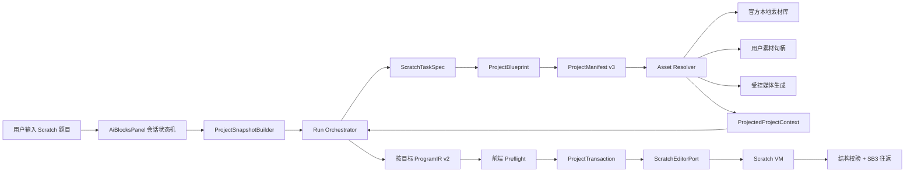

# AI 写积木与 Scratch Editor 深度集成完整优化方案

**文档状态**：待评审实施基线

**审计日期**：2026-09-04

**适用项目**：`D:/4Code/AI-Scratch-Web`

**当前依赖**：`@scratch/scratch-gui`、`@scratch/scratch-vm`、`@scratch/scratch-storage` 均为 `15.0.1`

**官方参考基线**：当前安装包 `15.0.1` 对应 npm `gitHead=5c49774f5b39a738e0d5506757de56fd7a9feea4`；同时参考 [`scratchfoundation/scratch-editor`](https://github.com/scratchfoundation/scratch-editor) `develop@cdd2a10735278753c7569c2e4bd166a6dc7ae2e9` 与 `v15.1.1`（2026-09-02）
**目标**：用户只需输入一道 Scratch 题目，系统即可在可审计、可撤销、可回滚的前提下，自动理解题意、匹配并导入角色/造型/背景/声音、创建变量与广播、生成并写入多角色积木程序，最终得到可导出、可重新加载的 SB3 项目。

---

## 1. 执行摘要

当前项目已经具备一条可用的 AI 写积木主链路：Vue 宿主挂载官方 Scratch GUI，后端生成严格的 `ProjectManifest`/`ProgramIR`，前端校验后通过 Scratch VM 写入资源与积木，并使用 SB3 备份实现失败恢复。它不是从零开始，也不需要改成“让模型直接生成 project.json”。真正需要解决的是以下五个结构性问题：

1. **声音没有进入资源合同**。官方 `sounds.json` 的 354 条记录及其 350 个唯一 WAV 文件已经被构建脚本缓存，但业务检索、计划、Prepare、Commit、补偿和类型声明都只认识角色、造型和背景。导入官方角色时还会主动丢弃角色自带声音。
2. **项目生成和项目写事务边界错误**。资源已经写入 VM 后，当前实现仍在事务锁内逐目标等待远程模型生成；单次超时可达 480 秒，最多 12 个目标。这会让编辑器长时间锁定，并放大网络故障后的恢复成本。
3. **项目上下文既重复又不完整**。每个目标最多携带 40 KB `current_program`，请求可包含 12 个目标，但整个 HTTP 请求上限只有 256 KB；与此同时 `shared_state` 固定为空，真实全局变量、列表和广播没有被提取。
4. **对官方 Scratch Editor 的集成过于脆弱**。构建脚本会用字符串替换补丁修改压缩后的 `scratch-gui-standalone.js`，积木写入又直接依赖 VM 内部 block 容器。官方仓库源码已经形成 standalone 入口，四类素材库也有公开导出，但 npm 实际发布物与仓库源码并不完全同步；必须以安装 tarball 的 capability probe 为准，并把事实 API 与不可避免的兼容层明确分级。
5. **题目计划还不是可验证的行为规格**。当前 `requirements` 主要是字符串数组，`plan` 只有 `steps: string[]`。它无法可靠表达每个行为由谁执行、读写哪些状态、广播生产者/消费者、资源用途和可自动执行的验收条件。

本方案冻结以下核心决策：

- 模型永远只输出受限的声明式合同，不接触 VM、target ID、素材二进制、URL、JavaScript 或 SB3。
- 浏览器仍是 Scratch 项目的唯一执行者；后端只负责需求、清单和 ProgramIR 生成及校验。
- 资源合同升级为 `ProjectManifest v3`，声音成为一等资源；官方角色默认保留全部原生造型和声音。
- 工作流拆成 **TaskSpec -> Blueprint -> Manifest -> Resolve Assets -> Projected Context -> Generate Programs -> Preflight -> Commit -> Verify**。所有远程请求、素材选择、下载、解码和生成都必须在 Commit 之前完成。
- ProgramIR 增加逻辑资源引用，声音积木引用 `op_id`，Commit 时再解析成 VM 实际安装名称，避免重名自动改名导致脚本失效。
- 默认自动采用高置信度官方素材；候选歧义、生图/生音、上传资源和破坏性修改才需要用户决策。
- Scratch GUI/VM/Storage 必须作为同一版本族原子升级；先用实际发布包能力探针选择接入方式，再删除压缩 bundle 补丁，所有 VM 调用收敛到兼容门面。
- 默认保持“整个 AI 操作原子化”：失败恢复到操作前 SB3；生成过但未挂载的媒体保留在本地素材库，避免昂贵结果丢失。

### 1.1 目标验收指标

| 指标 | 验收目标 |
| --- | --- |
| 官方素材自动化 | 高置信度角色、造型、背景、声音无需人工选择即可导入 |
| 声音完整性 | 官方角色原生声音不丢失；独立声音可导入舞台或角色并被积木正确引用 |
| 事务时长 | Commit 阶段不发 HTTP 请求、不等待模型、不弹选择器；普通项目锁定时间目标小于 5 秒 |
| 请求体积 | 项目请求软上限 64 KiB；超过预算先摘要化，不依赖 256 KiB 服务端硬上限兜底 |
| 数据正确性 | 每次成功提交均通过目标/资源/积木图校验，并通过 SB3 导出再加载集成测试 |
| 失败恢复 | 任一资源或程序写入故障均恢复到同一份操作前备份；故障注入测试恢复率 100% |
| 常见题完成率 | 固定 benchmark 中无需人工修复的端到端成功率 >= 90%，结构/编译通过率 >= 99% |
| 音频可靠性 | 官方 WAV 导入及 SB3 往返成功率 >= 99.5%，不得出现未报告的 `broken` fallback |
| 修复预算 | 每 run 修复不超过 3 次，P95 修复次数 <= 2 |
| 升级稳定性 | Scratch 包版本变化必须先通过上游兼容合同测试，禁止直接依赖新的压缩 bundle 字符串 |
| 隐私 | 生产日志不记录题目全文、对话、项目程序、模型原文、声音/图片内容或 VM 内部 ID |

---

## 2. 当前实现基线

### 2.1 真实调用链

```text
frontend/index.html
  -> ScratchHost.vue
     -> window.GUI.EditorState
     -> createStandaloneRoot
     -> onVmInit / onProjectLoaded
  -> App.vue
     -> AiBlocksPanel.vue
        -> UnifiedGenerationRunner.prepare()
           -> /api/ai-blocks/generate-unified（单目标）
           -> /api/ai-blocks/generate（项目清单）
        -> prepareProjectResources()
        -> UnifiedGenerationRunner.commit()
           -> applyProjectResources()
           -> 每个项目目标再次请求 project_program
           -> compileProgramIR()
           -> target.blocks.createBlock/moveBlock
        -> saveProjectSb3 / loadProject 回滚与撤销
```

关键实现位置：

| 责任 | 当前文件/符号 |
| --- | --- |
| GUI 生命周期 | `frontend/src/scratch/ScratchHost.vue:51-93` |
| VM 门面与事务 | `frontend/src/scratch/scratch-gui-bridge.ts` |
| 面板编排与项目上下文 | `frontend/src/ai-blocks/AiBlocksPanel.vue:162-216` |
| 统一 Prepare/Commit | `frontend/src/ai-blocks/generation-runner.ts:487-669` |
| 项目资源 Prepare | `frontend/src/ai-blocks/project-resource-preparer.ts` |
| 项目资源 Commit | `frontend/src/ai-blocks/project-resource-runner.ts`、`project-resource-executor.ts` |
| 资源合同 | `frontend/src/ai-blocks/project-plan.ts`、`backend/app/resource_contract.py` |
| ProgramIR 编译 | `frontend/src/ai-blocks/program-compiler.ts:324-451` |
| 后端路由 | `backend/app/routes/ai_blocks.py:76-205` |
| 分段生成与修复 | `backend/app/orchestration/orchestrator.py` |
| 模型请求日志 | `backend/app/providers/agnes_text_provider.py:35-43` |

### 2.2 已有能力，应保留而非重写

- `ProjectManifest v2` 已支持新增/删除角色、添加造型、添加/切换背景和多目标程序清单。
- `ProgramIR v1` 已支持变量、列表、广播、脚本位置、追加/修改/重写模式及核心原生 opcode 白名单。
- 前后端均有严格 schema、数量上限、图结构校验和模型输出 repair。
- Scratch 写入前已有 target/revision 快照检查，写入中已有根事务锁和变更归因。
- 已有 SB3 备份、失败补偿、整包恢复、生成后 revision-safe 撤销。
- 官方 `sprites.json`、`costumes.json`、`backdrops.json`、`sounds.json` 和素材二进制已在安装时本地化。
- 内置素材、生图、IndexedDB 素材库、画布 handoff 已形成 Prepare/Commit 雏形。

### 2.3 已确认缺口与严重度

| 优先级 | 缺口 | 直接后果 |
| --- | --- | --- |
| P0 | 声音不在 `ScratchAssetType`、资源合同和 bridge 中 | AI 无法导入题目要求的声音 |
| P0 | `buildSpriteImport` 固定 `sounds: []` | 官方角色自带音效被静默丢弃 |
| P0 | 项目程序在 Commit 锁内远程生成 | 编辑器可能被锁数分钟，取消和恢复成本高 |
| P0 | 每目标完整程序重复进入 `project_context` | 中型项目可触发 422/413，模型输入噪声显著 |
| P0 | `project_context.shared_state` 固定为空 | 多角色共享变量、列表、广播规划容易漂移 |
| P0 | `plan` 仅包含自由文本步骤 | 无法做跨角色行为一致性检查和题意级自动验收 |
| P1 | 任意正分素材直接取第一名 | “ball”“bat”等歧义词会自动导入错误素材 |
| P1 | 压缩 GUI bundle 字符串补丁 | Scratch 小版本升级即可构建失败或静默错补丁 |
| P1 | 完整模型请求和 delta 可进入日志 | 学生题目/项目内容泄漏及日志膨胀 |
| P1 | ProgramIR 的声音/造型/背景下拉仅是裸字符串 | VM 自动唯一命名后积木可引用不存在的名称 |
| P1 | E2E 仍拦截旧端点 | 测试可能通过但没有覆盖当前项目模式协议 |
| P2 | 自定义积木及画笔/音乐等扩展被拒绝 | 一部分中高阶 Scratch 题目无法自动完成 |
| P2 | block 写入依赖 `target.blocks` 内部实现 | 上游升级风险集中在核心写入路径 |

### 2.4 当前测试基线

2026-09-04 实际执行：

- 前端 `npm run test:unit -- --reporter=dot`：19 个测试文件中 18 个通过；129 个用例中 127 个通过、2 个失败。
- 两个失败均位于 `frontend/tests/project-resource-runner.test.ts`，fixture 没有把快照的当前 target 放进 `runtime.targets`，因此被新的快照完整性检查正确拒绝。
- `backend/.venv` 能导入 FastAPI 应用，但未安装 `pytest`/`pytest-asyncio`，测试在收集前即失败，因此当前不能把后端自动化测试视为可重复的绿色基线。
- 本轮未运行 Playwright E2E；静态审计确认现有 AI 积木 E2E 只拦截旧 `/generate-unified`，而项目模式实际走 `/generate`。

**实施门槛**：Phase 0 先修复/更新测试基础设施，禁止在已知红色基线上判断音频改造是否回归。

---

## 3. 官方 Scratch Editor 基线与集成边界

### 3.1 官方仓库现状

`scratch-editor` 已是 Scratch 编辑器的官方 monorepo。参考 commit 中包含：

- `packages/scratch-gui`：编辑器 UI、Redux 状态和各类素材选择器，也是运行时装配层。
- `packages/scratch-vm`：项目加载/导出、target、积木运行时、资源安装和执行引擎。
- `packages/scratch-storage`：图片/声音等资源的创建、缓存和加载。
- `packages/scratch-render`、`scratch-svg-renderer`、`scratch-paint`：渲染、SVG 处理和造型编辑。
- `packages/scratch-media-lib-scripts`：官方媒体库构建工具。

官方仓库 `develop@cdd2a107` 的源码入口已经包含 standalone，并保留四类 library；但**实际发布到 npm 的 `@scratch/scratch-gui@15.1.1` 只导出根入口和四类 library，并未导出 `./standalone`**：

```text
@scratch/scratch-gui
@scratch/scratch-gui/sprites
@scratch/scratch-gui/costumes
@scratch/scratch-gui/backdrops
@scratch/scratch-gui/sounds
```

仓库源码中的 `index-standalone.tsx` 会导出 `EditorState`、`createStandaloneRoot`、`ScratchStorage` 和配置类型；当前项目使用的 15.0.1 与 npm 15.1.1 均不能直接从该 subpath import。结论是：不能把“GitHub tag 中存在源码入口”等价成“npm package export 可用”。升级评审必须同时检查仓库 commit、registry metadata、实际 tarball 和 Vite 构建结果。

### 3.2 官方事实 API

以下入口在官方 `packages/scratch-vm/src/virtual-machine.js` 中存在，并被官方 GUI 自身调用：

| 能力 | VM 方法 | 官方 GUI/VM 语义 |
| --- | --- | --- |
| 加载项目 | `loadProject(input)` | 校验并加载 SB3/project JSON |
| 导出项目 | `saveProjectSb3()` | 序列化 project.json、造型和声音到 SB3 |
| 导入角色 | `addSprite(input)` | 接受 sprite2/sprite3 JSON 或归档；官方角色选择器直接调用它 |
| 导出角色 | `exportSprite(targetId)` | 生成包含 `sprite.json`、造型和声音的 sprite3 归档 |
| 添加造型 | `addCostume(md5ext, costume, targetId?)` | 安装后自动选中新造型 |
| 添加背景 | `addBackdrop(md5ext, backdrop)` | 添加到舞台并自动切换 |
| 添加声音 | `addSound(sound, targetId?)` | 经 `loadSound` 解码，写入目标并刷新目标列表 |
| 删除声音 | `deleteSound(index)` | 仅作用于 editing target，并返回恢复函数 |
| 分享/导入积木 | `shareBlocksToTarget(blocks, targetId, fromTargetId?)` | 官方 GUI 用于跨目标复制；会重分配 block ID、补变量引用并按 opcode 加载扩展 |
| 切换目标 | `setEditingTarget(targetId)` | 同步 VM 与 GUI 当前目标 |
| 刷新工作区 | `emitWorkspaceUpdate()` / `refreshWorkspace()` | 通知 GUI 重建积木工作区 |

官方 `sound-library.jsx` 把 `sounds.json` 条目转换为：

```ts
const vmSound = {
  name,
  md5: md5ext,
  format,
  rate,
  sampleCount
};
```

然后调用 `vm.addSound(vmSound)`。`load-sound.js` 会从 `runtime.storage` 取 Sound asset、解码并回填真实 `rate`/`sampleCount`；SB3 序列化会保留 `assetId`、`dataFormat`、`format`、`rate`、`sampleCount` 和 `md5ext`。

### 3.3 稳定性分层

| 层级 | 可用边界 | 本项目策略 |
| --- | --- | --- |
| A：公开包出口 | 当前 npm 根入口、四类 library JSON、ScratchStorage 类型 | 可直接依赖；版本必须锁定；subpath 以 tarball exports 为准 |
| B：VM 事实生命周期 API | `addSprite/addCostume/addBackdrop/addSound/loadProject/saveProjectSb3` | 只允许由 `ScratchGuiBridge` 调用，并有真实包集成测试 |
| C：半内部 target API | `getCostumes/getSounds/setCostume/createVariable` | 收敛到一个版本适配器；升级必须跑合同测试 |
| C2：VM 积木分享事实 API | `shareBlocksToTarget` | 优先做 hydrated graph 兼容验证；调用前必须阻断非白名单扩展 |
| D：内部积木容器 | `target.blocks.createBlock/moveBlock/deleteBlock`、`_blocks` | 仅作为经合同测试的兼容后备；集中隔离、尽量不读 `_blocks` |
| 禁止 | 修改 minified bundle、依赖压缩变量名、让模型输出 VM 方法/ID | Phase 1 删除并用公开配置替代 |

### 3.4 官方包升级策略

1. `scratch-gui`、`scratch-vm`、`scratch-storage`、`scratch-render` 等 Scratch 包必须以同一个官方 release 原子升级，禁止只升其中一个。
2. 候选版本为 `15.1.1`，先在独立分支运行兼容合同和 SB3 往返，不在音频功能 PR 中同时处理无关 UI 变化。审计时 15.0.1 与 15.1.1 的 `scratch-vm/src` 165 个文件逐字节一致，因此升级收益主要在 GUI/Storage 集成，不是 VM 声音语义变化。
3. 对实际安装 tarball 做 capability probe：只有 `package.json.exports['./standalone']` 存在且 Vite 验证通过时，`ScratchHost.vue` 才改用该入口。15.1.1 npm 包当前不满足此条件；短期继续加载**未修改**的官方 standalone dist，记录版本与 SHA-256。若团队决定直接从官方 commit 构建，则必须固定 commit、构建命令和产物哈希，不能悄悄混用 registry 包。
4. 使用 15.1.1 `GUIConfig.storage.getLibraryAssetUrl(assetId, dataFormat)` 提供本地素材预览 URL；VM 二进制加载继续通过 `ScratchStorage.addWebStore`。两条路径都指向 `/assets/scratch/library-assets/`。
5. 删除 `prepare-scratch-assets.mjs` 中 `withDeleteConfirmation` 和 CDN 字符串替换。AI 的删除行为走自己的危险操作确认；Scratch 原生手动删除继续保留官方确认行为。
6. 每次上游升级记录：旧/新版本、官方 release/commit、兼容测试结果、bundle 体积、素材数、SB3 fixture 结果和回滚版本。

### 3.5 许可与品牌

官方包声明 `AGPL-3.0-only`，并单独提供 `TRADEMARK`。部署或分发前必须由项目负责人完成 AGPL 源码提供义务、修改声明、依赖许可证清单和 Scratch 商标使用复核。本文只标记工程门槛，不代替法律意见。

---

## 4. 目标架构



### 4.1 模块职责

| 模块 | 唯一职责 |
| --- | --- |
| `ProjectSnapshotBuilder` | 从 VM 读取最小、可预算、无内部 ID 的逻辑项目上下文 |
| `RunOrchestrator` | 驱动 durable 状态机、重放事件、幂等决策和全局 retry budget |
| `GenerationOrchestrator` | 生成 TaskSpec、Blueprint、manifest 和每个 target 的 ProgramIR；分段 repair |
| `AssetResolver` | 搜索官方素材、判断置信度、取得用户选择/授权并准备全部字节 |
| `ProjectedProjectContext` | 在不写 VM 的情况下描述“提交后将存在”的角色、声音、造型和共享状态 |
| `ProgramPreflight` | 校验 IR、引用、目标能力、数量上限和依赖图；不写项目 |
| `ProjectTransaction` | revision 检查、一次 SB3 备份、短时 Commit、补偿/恢复和撤销凭据 |
| `ScratchEditorPort` | 屏蔽官方包版本差异；应用资源、变量和积木；读取安装结果 |
| `VerificationService` | 校验实际 VM 状态、导出 SB3、在隔离 VM 中重新加载 fixture |

### 4.2 依赖原则

- UI 不直接调用 VM。
- AI API 不引用 Scratch VM 类型。
- 资源 adapter 不依赖 Vue 组件。
- ProgramIR 编译器不下载资源、不发模型请求、不负责弹窗。
- 只有 `ScratchEditorPort`/`ScratchGuiBridge` 可以调用 VM 的事实 API。
- 内部 target/block API 的使用不得散落到 runner、面板或素材代码。
- 模型永远不能决定可信的 `md5ext`、本地 asset ID、URL 或 target ID。

### 4.3 信任边界与系统不变量

模型返回的所有对象都按“不可信提案”处理，后端通过 schema 不等于可以写 VM。系统必须长期维持以下不变量：

1. live Scratch VM 只由浏览器 `ScratchEditorPort` 修改；后端和模型没有 VM 写权限。
2. 模型只能使用本轮分配的逻辑 ID，不得看到或生成 target ID、asset ID、Blob URL、文件路径和二进制。
3. 进入 `committing` 前不得修改 live VM；进入后不得出现网络、用户选择、媒体解码或模型 repair。
4. 每次提交绑定 `editor_session_id + project_epoch + snapshot_hash`。任一值不匹配即拒绝写入。
5. 同一 run 只保留一份 durable SB3 backup 和一份顺序 journal；每个终态只能写一次。
6. 结构、引用、编译和 SB3 往返任一层未通过，结果都不能标记为完成。
7. 删除、rewrite、付费生成、外发用户素材和权限型扩展不能由模型自行授权。
8. 自动归一化只能修复无语义差异的格式问题；任何会改变目标、资源或玩法的修正必须重新校验或交给用户。

### 4.4 Agent 分工与中央编排

这里的“Agent”是后端编排器调用的受限生成阶段，不是多个可以任意操作项目的自治进程。所有阶段由单一 `RunOrchestrator` 状态机驱动：

| 阶段 | 输入 | 唯一输出 | 明确禁止 |
| --- | --- | --- | --- |
| Task Spec Agent | 题目、最小项目摘要、用户策略 | `ScratchTaskSpec` | 素材 ID、积木正文、VM 命令 |
| Blueprint Agent | TaskSpec、项目摘要 | `ProjectBlueprint` | 选择具体二进制、编造现有 target |
| Asset Resolver | Blueprint、可信本地 catalog | `ResolvedAsset[]` | 把检索结果当指令、任意 URL 下载 |
| Program Agent | 单 target 行为切片、共享合同、逻辑引用 catalog | 一个 `ProgramIR v2` | 修改其他 target、创建未声明资源 |
| Deterministic Validator | 全部结构化产物 | 有界诊断 | 进行语义猜测或静默改玩法 |
| Repair Agent | 失败 target/JSON Pointer/错误码/相关题意切片 | 失败片段替换 | 重跑整个项目、扩大权限 |
| Browser Executor | 已批准且预检通过的 `ResolvedExecutionPlan` | receipt、BindingTable、验证报告 | 调模型、下载资源、临时询问用户 |

每个 Program Agent 可并发，但共享状态、广播协议和 target 依赖由 Blueprint 先冻结。Repair 全 run 最多 3 次；相同错误签名连续出现两次即停止，避免供应商重试、阶段重试和客户端重试相乘。

---

## 5. 端到端自动工作流

### 5.1 状态机

```text
idle
  -> snapshotting
  -> specifying_task
  -> blueprinting
  -> planning_manifest
  -> resolving_assets
       -> needs_input/awaiting_asset_choice（仅歧义）
       -> needs_input/awaiting_generation_consent（仅生成媒体）
  -> generating_programs
  -> preflight
  -> ready_to_commit
  -> committing
  -> verifying（与 committing 共同构成短时、无网络的原子写窗口）
  -> completed

任意 Commit 前状态 -> cancelled：无 VM 项目变更
committing -> rolling_back -> failed_rolled_back
                         -> failed_needs_recovery（恢复失败）
verifying  -> rolling_back -> failed_rolled_back
                         -> failed_needs_recovery（恢复失败）
completed -> undo：revision 未变化时恢复操作前 SB3
```

`needs_input` 是可恢复暂停态，不丢弃已完成的 TaskSpec、候选、已生成媒体或 ProgramIR。`cancel`、`approve/decision` 和恢复操作都必须幂等；同一 run 只能产生一个 terminal state。

### 5.2 详细时序

1. **建立快照**：读取当前项目 revision、逻辑 target 列表、当前 target 脚本摘要、角色/造型/声音名称、全局/局部变量、列表和广播。
2. **理解题目**：生成 `ScratchTaskSpec`，冻结实体、触发、条件、动作、状态和验收条件，并记录采用的默认值。只有会改变核心玩法、评分、费用或删除范围的歧义才提问。
3. **构建行为蓝图**：生成 `ProjectBlueprint`，为每个行为分配 owner target，形成状态/广播依赖图、`AssetNeed` 和 `ProgramJob`。
4. **生成小清单**：由 Blueprint 派生 `ProjectManifest v3`，只描述资源操作、共享状态、扩展需求和待编程目标，禁止嵌入脚本正文。
5. **解析素材**：本地搜索四类官方 library；高置信度自动选择，歧义才要求选择；下载/校验/解码全部资源。媒体生成也在此阶段完成并保存到素材库。
6. **构造投影上下文**：把已解析资源转换成逻辑“提交后项目”，包括预计角色名、造型名、声音名和 `op_id`，但不写 VM。
7. **按目标生成程序**：一个目标一个 ProgramIR；独立目标最多并发 2 个，存在广播/共享状态依赖时按拓扑层生成。失败只 repair 当前目标。
8. **Preflight**：验证 TaskSpec -> Blueprint -> Manifest -> ProgramIR 的可追溯性，以及全部引用、目标类型、扩展、共享状态、脚本权限、总块数和项目 revision。任何错误都发生在锁定编辑器之前。
9. **Commit**：锁定 UI，重新检查 revision/hash，持久化一次 SB3 backup，按顺序创建资源与共享状态，建立实际 BindingTable，本地编译全部 ProgramIR 后注入目标，完成实际状态校验。
10. **Verify**：保持同一原子写窗口，导出候选 SB3，并在隔离 VM 中完成结构、往返和可执行的 behavior oracle；失败仍加载操作前 backup。验证通过、checkpoint 写为 `COMPLETED` 后才释放锁，UI 再展示实际创建结果、假设、跳过项和可撤销入口。普通项目的 Commit + Verify 合计目标小于 5 秒，超限题目在 Preflight 拒绝自动写入或降级为只生成方案。

### 5.3 为什么程序必须在 Commit 前生成

当前实现把逐目标 `project_program` 请求放在 `UnifiedGenerationRunner.commit()` 的循环里。网络超时、模型 repair 或用户取消都会发生在已经写入资源且编辑器被锁住之后。目标设计通过“投影上下文 + 逻辑资源引用”解除这个依赖：AI 无需提前知道 VM target ID 或重名后的真实字符串，所有程序都可以先生成和校验；Commit 中只剩确定性的本地操作。

### 5.4 自动化与用户决策边界

| 场景 | 默认行为 |
| --- | --- |
| 官方素材 top-1 高置信度且领先明显 | 自动采用，结果页显示来源 |
| 多个官方候选接近 | 暂停该资源并展示候选，不猜测 |
| 官方素材无合格候选，策略为 `builtin_first` | 请求一次生成授权；拒绝则跳过或返回题目不可完整实现 |
| 用户明确要求生成图片/声音 | 展示内容、用途、数量和来源后确认 |
| 删除角色/声音、rewrite 已有脚本 | 明确显示影响范围并确认 |
| 追加新角色、新声音、新脚本 | 可自动 Commit，保留整次撤销 |
| 重名 | 使用逻辑引用；Commit 后显示 VM 实际名称 |

### 5.5 题目理解合同：ScratchTaskSpec v1

现有 `RequirementsResponse + Plan.steps` 继续作为兼容展示层，但不能再承担执行依据。新增的 TaskSpec 必须把自然语言题目转换成可检查的玩法合同：

```ts
type LogicalTargetRef =
  | {kind: 'current_target'}
  | {kind: 'stage'}
  | {kind: 'existing_sprite'; name: string}
  | {kind: 'created_sprite'; op_id: string};

type OperandSpec =
  | {kind: 'literal'; value: string | number | boolean}
  | {kind: 'state'; state_id: string}
  | {kind: 'attribute'; entity_id: string; attribute: 'x' | 'y' | 'direction' | 'size' | 'visible'}
  | {kind: 'timer'}
  | {kind: 'random'; min: number; max: number};

type TriggerSpec =
  | {kind: 'green_flag'}
  | {kind: 'key_pressed'; key: string}
  | {kind: 'sprite_clicked'}
  | {kind: 'broadcast_received'; state_id: string}
  | {kind: 'backdrop_switched'; asset_purpose: string}
  | {kind: 'clone_started'}
  | {kind: 'timer_reached'; seconds: number};

type ConditionSpec =
  | {kind: 'compare'; left: OperandSpec; operator: 'eq' | 'gt' | 'gte' | 'lt' | 'lte'; right: OperandSpec}
  | {kind: 'touching'; entity_id: string}
  | {kind: 'touching_edge'}
  | {kind: 'key_down'; key: string}
  | {kind: 'logical'; operator: 'and' | 'or'; operands: ConditionSpec[]}
  | {kind: 'not'; operand: ConditionSpec};

type ActionSpec =
  | {kind: 'move_steps'; steps: OperandSpec}
  | {kind: 'set_axis'; axis: 'x' | 'y'; value: OperandSpec}
  | {kind: 'change_axis'; axis: 'x' | 'y'; delta: OperandSpec}
  | {kind: 'go_to_entity'; entity_id: string}
  | {kind: 'turn'; degrees: OperandSpec}
  | {kind: 'point_towards'; entity_id: string}
  | {kind: 'set_state'; state_id: string; value: OperandSpec}
  | {kind: 'change_state'; state_id: string; delta: OperandSpec}
  | {kind: 'broadcast'; state_id: string}
  | {kind: 'use_asset'; asset_kind: 'costume' | 'backdrop' | 'sound'; purpose: string; wait?: boolean}
  | {kind: 'set_visibility'; visible: boolean}
  | {kind: 'say'; text: string; seconds?: OperandSpec}
  | {kind: 'ask'; question: string}
  | {kind: 'create_clone'; entity_id: string}
  | {kind: 'delete_this_clone'}
  | {kind: 'wait'; seconds: OperandSpec}
  | {kind: 'loop'; mode: 'forever' | 'repeat' | 'repeat_until'; count?: OperandSpec; until?: ConditionSpec; actions: ActionSpec[]}
  | {kind: 'stop'; scope: 'this_script' | 'all'};

interface SuccessCriterionSpec {
  criterion_id: string;
  description: string;
  related_behavior_ids: string[];
  priority: 'must' | 'should';
}

interface ScratchTaskSpec {
  schema_version: 1;
  title: string;
  goal: string;
  assumptions: Array<{
    id: string;
    text: string;
    confidence: number;             // 0..1
    requires_confirmation: boolean;
  }>;
  entities: Array<{
    entity_id: string;
    role: 'stage' | 'sprite';
    description: string;
    existing_target_ref?: LogicalTargetRef;
  }>;
  state: Array<
    | {
        state_id: string;
        kind: 'variable';
        scope: 'global' | 'local';
        owner_entity_id?: string;
        initial_value?: string | number | boolean;
      }
    | {
        state_id: string;
        kind: 'list';
        scope: 'global' | 'local';
        owner_entity_id?: string;
        initial_value?: Array<string | number | boolean>;
      }
    | {
        state_id: string;
        kind: 'broadcast';
        scope: 'global';
      }
  >;
  behaviors: Array<{
    behavior_id: string;
    owner_entity_id: string;
    trigger: TriggerSpec;
    conditions: ConditionSpec[];
    actions: ActionSpec[];
    reads: string[];
    writes: string[];
  }>;
  success_criteria: SuccessCriterionSpec[];
  unsupported: Array<{requirement: string; reason_code: string}>;
}
```

这些联合是 TaskSpec v1 的受控语义词表，不是自由 `verb/args` 容器，也不是对 Scratch opcode 的一比一复制。新增语义必须提升 schema minor/capability 并补 TaskSpec -> ProgramIR 映射测试；未知动作进入 `unsupported`，不能塞入字符串绕过白名单。

题目理解规则：

- “点击绿旗后”“按空格键”“碰到边缘”等先解析成 trigger/condition，不只保留一句文本。
- “得分”“生命”“关卡”必须明确初值、作用域和写入者；无法确定且会改变评分时才询问。
- `broadcast` 的 `scope` 必须是 `global`；局部变量/列表必须有 `owner_entity_id`。`state_id` 从 TaskSpec 到后续合同保持不变，投影为 Manifest/ProgramIR 的同值 `ref_id`，不得另行改名。
- 未指定坐标、速度、音量等非核心参数可采用 Scratch 教学常用默认值，但必须进入 `assumptions`。
- 未指定素材外观时优先形成语义检索词，不让 Task Spec Agent 选择具体官方素材。
- 题目要求当前白名单无法表达时写入 `unsupported`，不得用近似 opcode 假装完成。
- `ready=true` 不能代表用户确认。是否继续由 `requires_confirmation` 和前端 policy 决定。

### 5.6 行为蓝图：ProjectBlueprint v1

Blueprint 把 TaskSpec 映射成资源需求、目标职责和可验证行为，但仍不包含素材 ID 或积木图：

```ts
interface BlueprintAcceptanceTestSpec {
  test_id: string;
  source_criterion_id: string;
  related_behavior_ids: string[];
  trigger:
    | {kind: 'green_flag'}
    | {kind: 'key'; key: string}
    | {kind: 'sprite_click'; entity_id: string}
    | {kind: 'broadcast'; state_id: string};
  arrange?: Array<
    | {kind: 'set_position'; entity_id: string; x: number; y: number}
    | {kind: 'set_state'; state_id: string; value: string | number | boolean | Array<string | number | boolean>}
    | {kind: 'set_timer'; seconds: number}
  >;
  expect: Array<
    | {kind: 'state'; state_id: string; comparator: 'eq' | 'gt' | 'gte' | 'lt' | 'lte'; value: unknown}
    | {kind: 'position_range'; entity_id: string; axis: 'x' | 'y'; min: number; max: number}
    | {kind: 'asset_used'; entity_id?: string; need_id: string}
    | {kind: 'broadcast_emitted'; state_id: string; min_count: number}
    | {kind: 'visibility'; entity_id: string; visible: boolean}
    | {kind: 'clone_count'; entity_id: string; comparator: 'eq' | 'gte' | 'lte'; value: number}
    | {kind: 'text_output'; entity_id?: string; text: string}
    | {kind: 'scripts_stopped'; entity_id?: string}
  >;
  timeout_ms: number;
}

interface ProjectBlueprint {
  schema_version: 1;
  task_spec_hash: string;
  asset_needs: Array<{
    need_id: string;
    kind: 'sprite' | 'costume' | 'backdrop' | 'sound';
    owner_entity_id?: string;
    purpose: string;
    search_terms: string[];
    tags: string[];
    fallback_order: Array<
      'project_asset' | 'scratch_library' | 'user_asset' |
      'image_generation' | 'audio_generation'
    >;
    constraints: {
      transparent?: boolean;
      max_bytes?: number;
      max_duration_ms?: number;
      animation_frames?: number;
    };
  }>;
  entity_bindings: Array<
    | {entity_id: string; resolution: {kind: 'existing_target'; target_ref: Exclude<LogicalTargetRef, {kind: 'created_sprite'}>}}
    | {entity_id: string; resolution: {kind: 'new_sprite'; need_id: string}}
  >;
  state_plan: Array<{
    ref_id: string;                    // 必须与 TaskSpec.state_id 相同
    kind: 'variable' | 'list' | 'broadcast';
    scope: 'global' | 'local';
    owner_entity_id?: string;          // local 时必填
    name: string;
    initial_value?: string | number | boolean | Array<string | number | boolean>;
  }>;
  behavior_graph: Array<{
    behavior_id: string;
    owner_entity_id: string;
    depends_on: string[];
    produces_broadcasts: string[];
    consumes_broadcasts: string[];
  }>;
  program_jobs: Array<{
    job_id: string;
    owner_entity_id: string;
    mode: 'append' | 'modify' | 'rewrite';
    behavior_ids: string[];
  }>;
  acceptance_tests: BlueprintAcceptanceTestSpec[];
}
```

在发起资源检索或 Program Agent 前做确定性蓝图检查：实体引用存在且每个实体恰有一个 binding；`new_sprite.need_id` 指向该实体的 sprite need；每个行为恰有一个 owner；状态读写引用已声明；局部状态 owner 与行为 target 相容；每个非外部广播至少有生产者和消费者；`program_jobs` 完整覆盖行为且不重复；危险 mode 已获 policy 授权；验收条件能追溯到题目 success criterion。这样可以在“积木 JSON 合法但角色职责分错”之前失败。

四层规划合同不能复制并各自成为事实来源。字段所有权和投影规则冻结如下：

| 唯一事实来源 | 拥有的语义 | 后续合同只能如何使用 |
| --- | --- | --- |
| TaskSpec | `entity_id/state_id/behavior_id/criterion_id` 与题意 | 原 ID 外键引用，不得改写玩法 |
| Blueprint | `need_id/job_id`、实体解析、状态归属、依赖 DAG | Manifest 必须逐项投影并保留 lineage |
| Manifest | `op_id`、可执行 target、资源/状态操作顺序 | Resolved Plan 只补可信素材、策略和 write-set |
| ProgramIR | 单个 `job_id` 的积木语义 | 只能引用上述 logical ID，不得新建未声明资源或状态 |
| BindingTable | VM 实际 target/state/asset ID 与安装名 | 仅浏览器可见，是 Commit 编译的最终权威 |

实现 `projectTaskSpecToBlueprint()`、`projectBlueprintToManifest()` 和 `buildResolvedExecutionPlan()` 三个纯函数或等价 validator。每层保存上游 canonical hash；所有 `entity_id/need_id/job_id/op_id/ref_id` 在各自命名空间唯一。任何漏投影、多投影或 hash 不一致都在 Preflight 失败，不能用名称相似度猜测补齐。

---

## 6. ProjectManifest v3 合同

### 6.1 顶层结构

```ts
interface ProjectManifestV3 {
  schema_version: 3;
  scope: 'project';
  summary: string;
  assumptions: string[];
  required_extensions: Array<'pen' | 'music' | 'text2speech' | 'translate' | 'videoSensing'>;
  resource_ops: ResourceOpV3[];
  shared_state: ProjectSharedStateV3;
  local_state: ProjectLocalStateV3[];
  program_targets: ProjectProgramTargetV3[];
}

interface ProjectSharedStateV3 {
  variables: Array<{
    ref_id: string;
    name: string;
    value?: string | number | boolean;
    scope: 'global';
  }>;
  lists: Array<{
    ref_id: string;
    name: string;
    value?: Array<string | number | boolean>;
    scope: 'global';
  }>;
  broadcasts: Array<{ref_id: string; name: string}>;
}

interface ProjectLocalStateV3 {
  ref_id: string;
  kind: 'variable' | 'list';
  target: Exclude<LogicalTargetRef, {kind: 'stage'}>;
  name: string;
  value?: string | number | boolean | Array<string | number | boolean>;
}

interface ProjectProgramTargetV3 {
  job_id: string;
  behavior_ids: string[];
  owner_entity_id: string;
  target: LogicalTargetRef;
  mode: 'append' | 'modify' | 'rewrite';
  intent: string;
}
```

约束：

- `resource_ops <= 24`、`program_targets <= 12`，现有限制先保持不变。
- `program_targets` 不能出现 `program`、`scripts` 或 VM block graph。
- 每个新增资源操作必须包含 Blueprint 的 `source_need_id`；创建角色的操作还必须包含 `owner_entity_id`。每个 `program_target.job_id` 必须一对一对应 Blueprint ProgramJob，并保留相同的 `behavior_ids/owner_entity_id`。
- `shared_state/local_state` 的 `ref_id` 必须与 TaskSpec 的 `state_id` 完全相同。广播只能进入 shared state；local variable/list 必须绑定到其 owner target，并在安装资源后、编译程序前统一创建。
- `required_extensions` 必须来自产品白名单；MVP 只允许空数组，扩展支持见第 12 章。
- `assumptions` 只记录会影响结果的默认值，最多 10 项，每项 120 字符。
- 所有字符串 NFKC 归一化、trim、控制字符过滤；逻辑名称比较使用 Unicode case-fold。
- 单目标纯积木请求可继续直接生成 ProgramIR；一旦涉及新增资源、新状态或其他 target，即提升为 project scope，不让同一种 manifest 同时承担两套语义。项目范围的 ProgramIR v2 不得自行声明新变量、列表或广播。

### 6.2 素材来源

```ts
type ScratchAssetType = 'sprite' | 'costume' | 'backdrop' | 'sound';

type ProposedResourceSourceV3 =
  | {
      kind: 'scratch_library';
      asset_type: ScratchAssetType;
      search_terms: string[];
    }
  | {
      kind: 'image_generation';
      reason: string;
      prompt: string;
      style: string;
      width: number;
      height: number;
      sheet_layout: '1x1';
    }
  | {
      kind: 'audio_generation';
      reason: string;
      prompt: string;
      audio_kind: 'sound_effect' | 'speech' | 'music';
      max_duration_seconds: number;
    };
```

安全规则：

- `ProposedResourceSourceV3` 是模型可输出的范围，刻意不包含 `user_asset` 或任何 handle。用户预选素材由浏览器按 `need_id` 绑定；未预选时由 Asset Resolver 进入 `needs_input`，随后直接形成 `ResolvedAsset`，不要求模型重写 Manifest。
- Blueprint 的 `fallback_order=user_asset` 只是允许宿主考虑用户素材，不等于授权模型选择某条本地记录。实际 `preparedHandle` 只存在于浏览器生成的 Resolved Plan。
- 所有 source 禁止 URL、base64、data URI、文件路径、asset ID、md5 和 VM ID。
- `audio_generation` 为后续能力；第一阶段后端 schema 可识别但 capability 为 false，前端不得发送生成请求。

### 6.3 声音操作

```ts
type SoundTargetRef =
  | {kind: 'current_target'}
  | {kind: 'stage'}
  | {kind: 'existing_sprite'; name: string}
  | {kind: 'created_sprite'; op_id: string};

interface AddSoundOp {
  op: 'add_sound';
  op_id: string;
  source_need_id: string;
  target: SoundTargetRef;
  name: string;
  source:
    | (Extract<ProposedResourceSourceV3, {kind: 'scratch_library'}> & {asset_type: 'sound'})
    | Extract<ProposedResourceSourceV3, {kind: 'audio_generation'}>;
  tags?: string[];
}

interface DeleteSoundOp {
  op: 'delete_sound';
  op_id: string;
  target: SoundTargetRef;
  sound: {kind: 'existing_sound'; name: string};
}
```

`delete_sound` 属于危险操作，默认 capability 关闭；只有用户明确要求且完成影响确认时启用。

**不设计 `select_sound`**：Scratch 项目没有类似 `currentCostume` 的“当前声音”持久状态。选择一个声音的业务含义应由 `sound_play`/`sound_playuntildone` 的菜单引用表达，而不是伪造一个资源状态操作。

### 6.4 官方角色声音保留

```ts
interface AddBuiltinSpriteOp {
  op: 'add_builtin_sprite';
  op_id: string;
  source_need_id: string;
  owner_entity_id: string;
  name: string;
  x: number;
  y: number;
  size: number;
  source: Extract<ProposedResourceSourceV3, {kind: 'scratch_library'}> & {asset_type: 'sprite'};
  include_costumes: 'all';
  include_sounds: 'all' | 'none'; // 默认 all
}

interface AddSpriteOpV3 {
  op: 'add_sprite';
  op_id: string;
  source_need_id: string;
  owner_entity_id: string;
  name: string;
  x: number;
  y: number;
  size: number;
  costumes: Array<{
    name: string;
    source:
      | (Extract<ProposedResourceSourceV3, {kind: 'scratch_library'}> & {asset_type: 'costume'})
      | Extract<ProposedResourceSourceV3, {kind: 'image_generation'}>;
  }>;
}

interface AddCostumeOpV3 {
  op: 'add_costume';
  op_id: string;
  source_need_id: string;
  target: Exclude<LogicalTargetRef, {kind: 'stage'}>;
  name: string;
  source:
    | (Extract<ProposedResourceSourceV3, {kind: 'scratch_library'}> & {asset_type: 'costume'})
    | Extract<ProposedResourceSourceV3, {kind: 'image_generation'}>;
  select_after?: boolean;
}

interface AddBackdropOpV3 {
  op: 'add_backdrop';
  op_id: string;
  source_need_id: string;
  name: string;
  source:
    | (Extract<ProposedResourceSourceV3, {kind: 'scratch_library'}> & {asset_type: 'backdrop'})
    | Extract<ProposedResourceSourceV3, {kind: 'image_generation'}>;
  select_after?: boolean;
}

type ResourceOpV3 =
  | AddBuiltinSpriteOp
  | AddSpriteOpV3
  | AddCostumeOpV3
  | AddBackdropOpV3
  | {op: 'delete_sprite'; op_id: string; target: Extract<LogicalTargetRef, {kind: 'existing_sprite'}>; name: string}
  | {
      op: 'select_backdrop';
      op_id: string;
      backdrop:
        | {kind: 'existing_asset_ref'; asset_type: 'backdrop'; name: string}
        | ResourceRefInputIR;
    }
  | AddSoundOp
  | DeleteSoundOp;
```

选择官方角色等价于官方 GUI 的语义：默认导入 manifest 中全部造型和全部声音。只有题目明确要求静音角色或资源预算策略明确关闭时才使用 `none`，不得继续静默写死 `sounds: []`。

### 6.5 示例：带角色和声音的题目清单

题目：“点击绿旗后，添加篮球角色；小猫播放 Meow，然后一直追着篮球移动，碰到篮球得分加 1。”

```json
{
  "schema_version": 3,
  "scope": "project",
  "summary": "小猫追逐篮球并计分",
  "assumptions": ["初始得分为 0", "每次碰到篮球只增加一次得分"],
  "required_extensions": [],
  "resource_ops": [
    {
      "op": "add_builtin_sprite",
      "op_id": "sprite_ball",
      "source_need_id": "need_ball",
      "owner_entity_id": "entity_ball",
      "name": "Basketball",
      "x": 120,
      "y": 0,
      "size": 70,
      "source": {
        "kind": "scratch_library",
        "asset_type": "sprite",
        "search_terms": ["basketball", "篮球"]
      },
      "include_costumes": "all",
      "include_sounds": "all"
    },
    {
      "op": "add_sound",
      "op_id": "sound_meow",
      "source_need_id": "need_meow",
      "target": {"kind": "current_target"},
      "name": "Meow",
      "source": {
        "kind": "scratch_library",
        "asset_type": "sound",
        "search_terms": ["meow", "猫叫"]
      }
    }
  ],
  "shared_state": {
    "variables": [{"ref_id": "state_score", "name": "得分", "value": 0, "scope": "global"}],
    "lists": [],
    "broadcasts": []
  },
  "local_state": [],
  "program_targets": [
    {
      "job_id": "job_cat",
      "behavior_ids": ["behavior_cat_start", "behavior_cat_chase", "behavior_cat_score"],
      "owner_entity_id": "entity_cat",
      "target": {"kind": "current_target"},
      "mode": "append",
      "intent": "绿旗后播放猫叫，持续朝篮球移动，首次接触后增加得分"
    }
  ]
}
```

示例前提是当前逻辑 target 已由 ProjectDigest 确认为题目中的小猫；若当前 target 是舞台或其他角色，TaskSpec 必须绑定唯一的 `existing_sprite`，不能把“小猫”自动等同于当前选择。

### 6.6 AI 清单与宿主执行计划必须分层

`ProjectManifest v3` 仍是模型表达“需要什么”的语义清单，不是可执行命令。资源解析完成后，由浏览器宿主生成不可由模型伪造的 `ResolvedExecutionPlan`：

```ts
interface ResolutionEvidence {
  catalogVersion?: string;
  query: string[];
  confidence: number;
  margin: number;
  candidates: Array<{catalogId: string; name: string; score: number}>;
}

type ResolvedAsset =
  | {
      needId: string;
      source: 'project_asset';
      existingRef:
        | {asset_type: 'sprite'; target_ref: Extract<LogicalTargetRef, {kind: 'existing_sprite'}>}
        | {asset_type: 'costume' | 'backdrop' | 'sound'; owner_target_ref: LogicalTargetRef; name: string};
      evidence: ResolutionEvidence;
    }
  | {
      needId: string;
      opId: string;
      source: 'scratch_library' | 'user_asset' | 'image_generation' | 'audio_generation';
      preparedHandle: string;       // 本地 Blob store/IndexedDB 句柄
      desiredName: string;
      trustedAssetId?: string;      // 由 catalog 或本地字节计算，绝不来自模型
      contentSha256: string;
      mimeType: string;
      byteLength: number;
      metadata: Record<string, unknown>;
      evidence: ResolutionEvidence;
      provenance: {provider?: string; sourceUri?: string; license?: string};
    };

interface PolicyReceipt {
  digest: string;
  granted_capabilities: Array<
    'additive_edit' | 'delete' | 'rewrite' | 'paid_generation' |
    'send_user_asset' | 'permissioned_extension'
  >;
  decision_ids: string[];
  issued_at: number;
  expires_at: number;
}

interface ResolvedWriteSet {
  target_refs: LogicalTargetRef[];
  resource_op_ids: string[];
  state_ref_ids: string[];
  changes_target_order: boolean;
}

interface ResolvedExecutionPlan {
  schema_version: 1;
  run_id: string;
  base: {
    editor_session_id: string;
    project_epoch: number;
    snapshot_hash: string;
    task_spec_hash: string;
    blueprint_hash: string;
    manifest_hash: string;
  };
  assets: ResolvedAsset[];
  ordered_operations: ResourceOpV3[];
  shared_state: ProjectSharedStateV3;
  local_state: ProjectLocalStateV3[];
  programs: Array<{job_id: string; target_ref: LogicalTargetRef; program: ProgramIRV2}>;
  acceptance_tests: AcceptanceTestSpec[];
  lineage: {
    need_bindings: Array<
      | {need_id: string; kind: 'resource_op'; op_id: string}
      | {need_id: string; kind: 'existing_asset'; existing_ref: string}
    >;
    entity_to_target: Array<{entity_id: string; target_ref: LogicalTargetRef}>;
    job_to_target: Array<{job_id: string; target_ref: LogicalTargetRef}>;
  };
  write_set: ResolvedWriteSet;
  policy_receipt: PolicyReceipt;
}
```

二进制只通过 `preparedHandle` 在本地组件间传递，不进入 prompt、SSE、日志或 manifest JSON。`ResolvedAsset` 是浏览器内部可信对象，所以可以包含 `user_asset` 和句柄；它不是模型合同。Plan 在进入 Commit 前计算 canonical JSON hash；Commit 只接受 hash 未变、句柄仍有效、lineage 完整、write-set 未冲突且 policy receipt 未过期的计划。这样即使素材名称或元数据包含提示注入文本，也只能作为数据，不会获得工具权限。

---

## 7. ProgramIR v2 与逻辑资源引用

### 7.1 现有问题

当前声音、造型、背景和目标菜单值都是普通 `text`。Scratch 在安装重名资源时会调用 `unusedName` 自动改名，例如第二个 `Meow` 可能变成 `Meow2`。若模型仍输出 `Meow`，生成出来的积木会播放旧声音或找不到预期资源。

### 7.2 新输入类型

```ts
interface ResourceRefInputIR {
  kind: 'resource_ref';
  ref: {
    op_id: string;
    value: 'installed_name';
  };
}

interface ExistingAssetRefInputIR {
  kind: 'existing_asset_ref';
  asset_type: 'costume' | 'backdrop' | 'sound' | 'sprite';
  name: string;
}

interface StateRefFieldIR {
  kind: 'state_ref';
  state_kind: 'variable' | 'list' | 'broadcast';
  ref_id: string;
}

type FieldValueIRV2 = string | number | boolean | StateRefFieldIR;

interface BlockInputIRV2 {
  kind: 'block';
  block: BlockIRV2;
}

type InputIRV2 = ScalarInputIR | BlockInputIRV2 | ResourceRefInputIR | ExistingAssetRefInputIR;

interface BlockIRV2 {
  opcode: string;
  fields?: Record<string, FieldValueIRV2>;
  inputs?: Record<string, InputIRV2>;
  substacks?: {
    SUBSTACK?: BlockIRV2[];
    SUBSTACK2?: BlockIRV2[];
  };
}

interface ScriptIRV2 {
  id: string;
  purpose: string;
  x: number;
  y: number;
  blocks: BlockIRV2[];
}

interface ProgramIRV2 {
  schema_version: 2;
  summary: string;
  remove_script_ids: string[];
  scripts: ScriptIRV2[];
}
```

`ProgramIRV2` 的递归节点只能使用 `BlockIRV2/InputIRV2/FieldValueIRV2`，不能在嵌套 reporter 中退回 v1 的 `BlockIR`。项目范围的新状态全部由 Manifest 的 `shared_state/local_state` 声明并在编译前绑定，因此 v2 不再复制 `variables/lists/broadcasts` 创建数组；单目标快捷路径一旦需要新状态，也必须提升为 project scope。

示例：

```json
{
  "opcode": "sound_playuntildone",
  "inputs": {
    "SOUND_MENU": {
      "kind": "resource_ref",
      "ref": {"op_id": "sound_meow", "value": "installed_name"}
    }
  }
}
```

### 7.3 Commit 符号表

```ts
interface InstalledTargetBinding {
  opId: string;
  targetId: string;        // 仅浏览器内部
  installedName: string;   // VM 回读值
  isStage: boolean;
}

interface InstalledMediaBinding {
  opId: string;
  kind: 'costume' | 'backdrop' | 'sound';
  ownerTargetId: string;   // 仅浏览器内部
  installedName: string;   // VM 回读值
  assetId: string;         // 仅浏览器内部
  index?: number;
}

interface BindingTable {
  targets: Map<string, InstalledTargetBinding>;     // key = stage/existing locator 或创建角色 op_id
  resources: Map<string, InstalledMediaBinding>;    // key = 单项媒体 resource op_id；sprite archive 没有单一 assetId
  state: Map<string, {id: string; name: string; kind: 'variable' | 'list' | 'broadcast'; ownerTargetId: string}>;
}
```

执行采用两遍编译：Preflight 用类型化的 symbolic binding 验证每个引用和完整 block graph，不需要真实 VM 名称；Commit 安装完全部资源、全局状态和局部状态后，从 VM 回读完整 `BindingTable`，再一次性解析所有程序。只有全部程序都解析和编译成功，才创建第一个 block。`resource_ref` 根据目标菜单类型查询 target 或 media binding，并替换为真实字符串；`state_ref` 被替换为 VM 的 name/id 对。

Scratch 的声音 primitive 最终先按**大小写敏感的声音名称**查找，找不到时还会把字符串尝试解释为 1-based index；因此不能把期望名称或数字字符串直接作为声音绑定。编译器必须使用 VM 回读的 `installedName`，并拒绝不属于当前 target 的声音 binding。

### 7.4 对现有资源的引用

- `existing_asset_ref` 必须在快照中唯一命中；同名两个资源视为歧义。
- 编译前验证 `sound_*` 菜单只能引用当前目标的声音。
- `looks_switchcostumeto` 只能引用当前角色造型。
- 背景引用解析到舞台背景；角色/克隆下拉解析到原始角色名。
- 模型不得把 `op_id` 填到普通 text 中绕过解析器。
- 变量、列表、广播引用优先使用 TaskSpec/Blueprint 分配的 `state_id`；只有 v1 兼容输入才允许按名称唯一解析。

### 7.5 兼容迁移

- `ProgramIR v1` 继续支持裸字符串，但只能引用快照中已存在且唯一的素材。
- 任何本轮新增资源必须使用 `resource_ref`，禁止 v1 裸字符串引用。
- 后端按 `program_schema_version` 选择严格 schema；前端双版本 validator 在一个发布周期内并存。

---

## 8. 声音资源完整实现

### 8.1 检索层

扩展 `frontend/src/ai/scratch-library.ts`：

```ts
export type ScratchAssetType = 'sprite' | 'costume' | 'backdrop' | 'sound';

export interface ScratchSoundItem {
  name: string;
  assetId: string;
  md5ext: string;
  dataFormat: 'wav' | 'mp3';
  format?: string;
  tags: string[];
  rate: number;
  sampleCount: number;
}

export interface ScratchSpriteItem {
  // 现有字段
  sounds: ScratchSoundItem[];
}
```

同时修改：

- `manifestPaths.sound = '/assets/scratch/libraries/sounds.json'`。
- `scratchAssetUrl` 接受 `wav|mp3`，并按预期 asset type 检查扩展名，避免视觉调用误取音频。
- `preloadScratchSound` 返回字节、格式和 manifest 元数据。
- 中文别名库加入“猫叫、胜利、失败、鼓掌、爆炸、跳跃、背景音乐”等常见课堂题目词。
- 角色搜索结果保留 `sounds`，不再用窄类型静默裁掉字段。

### 8.2 置信度匹配

当前“总分大于 0 就取第一名”必须替换为显式决策：

```ts
interface AssetMatchDecision<T> {
  status: 'auto' | 'review' | 'missing';
  top?: T;
  candidates: Array<{item: T; confidence: number; reasons: string[]}>;
}
```

建议初始阈值（必须用题库评测集校准）：

- `top.confidence >= 0.82` 且与第二名差值 `>= 0.15`：`auto`。
- `top.confidence >= 0.55` 但不满足领先条件：`review`。
- 低于 `0.55`：`missing`。

特征至少包括规范化名称完全匹配、别名完全匹配、标签匹配、分词匹配、资产类型、题目语境和负向词。阈值应由配置和离线评测控制，不散落在组件内。

### 8.3 Prepare 数据

```ts
interface SoundExport {
  name: string;
  blob: Blob;
  dataFormat: 'wav' | 'mp3';
  format?: string;
  rate?: number;
  sampleCount?: number;
}

type PreparedResource =
  | ExistingPreparedVisualKinds
  | {op_id: string; kind: 'sound'; value: SoundExport}
  | {op_id: string; kind: 'sprite'; value: SpriteExportWithSounds};
```

Prepare 必须完成：

1. 下载或读取全部声音字节。
2. 校验大小、格式 magic bytes、可解码性和时长。
3. 官方 manifest 的 `assetId` 必须与 `md5ext` 前缀一致；自定义资产重新计算 MD5。
4. 生成 `SoundExport`，但不修改 VM。
5. 释放预听 AudioBuffer/ObjectURL；PreparedResource 只保留 Blob/Uint8Array 和元数据。

产品初始限制建议为单文件 10 MiB、单声音 300 秒、一次计划最多 12 个声音；这属于本项目防护限制，不声称是 Scratch 官方上限。

### 8.4 角色导入

推荐用官方 sprite3 归档格式替代当前内联 costume 私有结构：

```text
Prepared sprite3 archive
  sprite.json
  <costume-asset-id>.svg/png
  <sound-asset-id>.wav/mp3
```

`vm.exportSprite()` 也生成同样结构。Prepare 阶段用已有 `fflate` 构建归档，Commit 阶段把 `ArrayBuffer` 交给 `vm.addSprite()`。这样可以一次走官方 parser/deserialize 生命周期，保留全部造型和声音，同时保证 Commit 不再下载资源。

迁移期间若继续使用当前 JSON 导入方式，则必须在角色创建后、同一 bridge 操作内依次调用 `vm.addSound(sound, newTargetId)`；任一声音失败即删除整个新角色。长期目标仍是 sprite3 归档，因为它与官方导入/导出路径一致。

### 8.5 Bridge API

新增：

```ts
interface ScratchEditorPortSoundApi {
  addSoundToTarget(
    targetId: string,
    sound: SoundExport
  ): Promise<{
    assetId: string;
    installedName: string;
    soundIndex: number;
    dataFormat: 'wav' | 'mp3';
    rate: number;
    sampleCount: number;
  }>;

  removeSoundFromTarget(
    targetId: string,
    soundIndex: number,
    expectedAssetId: string,
    compensation?: boolean
  ): Promise<void>;
}
```

`addSoundToTarget` 实现要点：

1. 用 `storage.createAsset(AssetType.Sound, DataFormat.WAV/MP3, bytes, null, true)` 构造 asset。
2. 传给 VM 的对象至少包含 `asset`、`assetId`、`md5`、`name`、`dataFormat`、`format`、`rate`、`sampleCount`。
3. 调用 `vm.addSound(soundObject, targetId)`，不需要切换 editing target。
4. 调用前保存 `getSounds()` 的对象集合和数量；调用后要求恰好出现一个新声音对象，不能只按名称定位。
5. 校验新对象没有 `broken`、实际 `assetId` 等于预期、`md5/dataFormat` 一致，并取得 VM 唯一化后的实际名称。
6. live GUI 中必须有非空 `soundId`、对应 sound player、正数 `rate/sampleCount`；时长 `sampleCount / rate` 与 Prepare 解码值在容差内。
7. 校验通过后才写入 BindingTable；任一条件失败，删除新对象并抛错，让根事务决定补偿或 SB3 恢复。

这里存在一个容易造成“假成功”的官方语义：`load-sound.js` 捕获资源缺失或解码错误后，会加载 Storage 的默认声音，把原始元数据放进 `broken`，随后 Promise 仍可 resolve；`virtual-machine.addSound()` 接着仍会把该对象加入 target。因此 `await vm.addSound()` 完成只代表生命周期结束，不代表请求的音频被正确安装。视觉资源的 `load-costume.js` 也有相似 fallback，造型/背景同样必须检查 `broken`、实际 asset ID、`skinId`、旋转中心和数量。

隔离验证 VM 如果没有绑定 AudioEngine，官方实现不会产生 `soundId`。这种环境只能验证 SB3 结构，不能声称完成了解码验证；生产 live GUI 必须把 AudioEngine capability 作为声音功能启用条件。

`deleteSound` 只作用于 editing target，因此删除/补偿必须保存原 editing target、切换、校验 index 和 asset ID、执行、再恢复原 target。该细节只能存在于 bridge。

### 8.6 事务日志

```ts
type ApplyEntry =
  | ExistingApplyEntries
  | {
      kind: 'sound';
      opId: string;
      targetId: string;
      soundIndex: number;
      assetId: string;
    };
```

journal 先用于归因、checkpoint 和故障诊断；普通失败由根事务直接加载整个 SB3 backup。仅当整包加载失败或出现不能覆盖的非本次 revision 时，才按 journal 逆序补偿本 run 的声音等 mutation；如果 index/asset ID 已变化就停止局部补偿并进入人工恢复，不能继续猜测删除。生成媒体的 IndexedDB 记录不进入项目补偿 journal，只标记为 `unattached`，让用户仍可在素材库复用。

### 8.7 SB3 验证

成功提交后，测试至少断言：

- `project.json.targets[*].sounds` 包含正确的 `assetId/dataFormat/md5ext/rate/sampleCount/name`。
- zip 根目录存在对应 wav/mp3 文件且 MD5 与文件名一致。
- 在一个新的 VM+Storage 实例中 `loadProject(sb3)` 成功。
- `getSounds()` 数量和实际名称一致。
- 运行包含 `sound_play` 的最小脚本时不产生缺失 sound player 错误。

---

## 9. 项目上下文与请求预算

### 9.1 新的逻辑快照

禁止把 VM target ID 发给模型。使用短期逻辑引用：

```ts
interface ProjectDigest {
  revision: number;
  targets: Array<{
    ref: {kind: 'stage'} | {kind: 'current_target'} | {kind: 'existing_sprite'; name: string};
    name: string;
    is_stage: boolean;
    costumes: string[];
    sounds: string[];
    variables: Array<{name: string; scope: 'local' | 'global'}>;
    lists: Array<{name: string; scope: 'local' | 'global'; length: number}>;
    scripts: Array<{ref: string; purpose: string; trigger: string; block_count: number}>;
  }>;
  shared_state: {
    variables: Array<{name: string; value?: string | number | boolean}>;
    lists: Array<{name: string; length: number; preview?: Array<string | number | boolean>}>;
    broadcasts: string[];
  };
}
```

### 9.2 发送规则

- Manifest 请求只发送项目 digest，不发送任何完整 ProgramIR。
- 某 target 的程序请求只发送该 target 的完整可修改脚本、其他 target 的脚本摘要、manifest 和共享状态。
- 大列表只发长度和最多 5 项 preview；除非题意明确依赖内容，不发送完整值。
- 对话历史保留最近有效轮次和一份结构化 session summary，不能无限追加 40 条完整消息。
- 请求序列化后先计算 UTF-8 字节数。超过 64 KiB 时依次裁剪 reasoning、旧消息、非当前脚本细节和列表 preview；仍超预算则提示拆分需求，不把问题拖到服务端 413。
- 后端保留 256 KiB 硬限制，用于安全而非正常流量预算。

### 9.3 真实 shared state 提取

- 舞台 target 的普通变量/列表作为全局状态。
- 原始角色上的普通变量/列表作为局部状态，并带逻辑 target ref。
- `broadcast_msg` 从舞台变量表及积木引用合并去重。
- 同名 local/global 合法，但 ProgramIR resolver 必须结合 scope 与目标解析。
- `ProjectManifest.shared_state` 表示本次操作期望创建/复用的全局状态，`local_state` 表示按逻辑 target 创建/复用的局部变量和列表；二者都不能再固定为空对象或交给各 ProgramIR 重复创建。

### 9.4 投影上下文

资源 Prepare 后，根据 manifest 和匹配结果生成 `ProjectedProjectContext`：

- 新角色使用 `created_sprite.op_id`；不预测 VM target ID。
- 新造型/背景/声音保留 `op_id` 和期望名。
- 程序引用这些逻辑 ID，不依赖真实安装名。
- 预计名称只用于人类可读 prompt；Commit 符号表是最终权威。

---

## 10. AI 编排与协议优化

### 10.1 分段合同

```text
task_spec -> blueprint -> project_manifest -> resolved_assets -> projected_context
projected_context + program_job[1] -> ProgramIR[1]
projected_context + program_job[2] -> ProgramIR[2]
all ProgramIR + resolved plan -> preflight -> commit -> verify
```

每段只允许一个结构化对象。现有 requirements/plan 在兼容期由 TaskSpec/Blueprint 投影得到，用于 UI 展示，不再反向作为执行真相。后端继续使用 Pydantic `extra='forbid'` 和供应商原生 JSON Schema/tool call；不支持严格结构化输出的 provider 才回退 JSON object，XML-like tagged stream 只保留给旧协议。repair 只携带有限诊断和失败对象的受限片段，不重复整个项目上下文。

### 10.2 程序生成调度

- 先根据广播、共享变量写入和 target intent 建立依赖 DAG。
- 同一拓扑层最多并发 2 个目标；结果按 manifest 顺序稳定归档。
- 每个目标首次生成加最多 2 次结构 repair；transport retry 与 schema repair 分开计数。
- 一个目标失败只重试该目标，不重跑 requirements、manifest 或已成功目标。
- 所有目标成功并通过前端 validator 后，才允许进入 Commit。

### 10.3 SSE 事件合同

所有事件使用版本化 envelope；供应商原始 delta 不直接成为前端协议：

```json
{
  "protocol_version": "ai-scratch-run/1",
  "run_id": "run_01...",
  "event_id": "evt_01...",
  "sequence": 27,
  "phase": "generating_programs",
  "type": "program_target_ready",
  "attempt": 1,
  "job_id": "job_apple",
  "payload": {}
}
```

建议事件：

```text
phase_started
task_spec_ready
blueprint_ready
manifest_ready
asset_resolution_required
program_target_started
program_script_ready
program_target_ready
validation_failed
repair_started
generation_complete
generation_error
```

前端必须校验：

- `sequence` 递增且不重复。
- ready 事件与请求的 `output_contract` 一一对应。
- program 事件必须携带当前 Blueprint/Manifest 中存在的 `job_id`；resource 事件必须携带存在的 `op_id`；其他事件禁止用 `null` 占位伪造关联键。
- terminal 事件只出现一次；断流且无 terminal 视为失败。
- 旧 `project_ready` 等事件必须明确拒绝，而不是静默忽略。
- `event_id` 可用于 `Last-Event-ID` 重连；服务端按 run 保留有界事件记录，重放不会重复执行阶段副作用。
- UI 只显示阶段摘要、产物摘要和可行动错误，不透传供应商隐藏推理文本。

### 10.4 端点收敛

当前单目标走 `/generate-unified`、项目走 `/generate`，已经造成 E2E 拦截漂移。目标 v3 使用可恢复的 run resource，而不是让一次 POST 长连接承担整个生命周期：

```text
POST /api/ai-runs                         创建 run，返回 run_id
GET  /api/ai-runs/{run_id}                读取状态和产物摘要
GET  /api/ai-runs/{run_id}/events         SSE；支持 Last-Event-ID
POST /api/ai-runs/{run_id}/decisions      提交素材/策略决策，带 idempotency_key
POST /api/ai-runs/{run_id}/tool-results    回传浏览器素材解析摘要，带 tool_call_id 与 idempotency_key
POST /api/ai-runs/{run_id}/cancel         幂等取消
```

浏览器 VM 的 Prepare/Commit 结果不直接交给模型工具执行。`tool-results` 只接受 `need_id`、选定来源类别、面向模型的规范化名称/tags、尺寸或时长摘要和逻辑 `op_id`，禁止二进制、handle、URL、asset ID 与 VM ID。服务端校验 `run_id + tool_call_id + expected_project_epoch + idempotency_key`，以 `(run_id, tool_call_id)` 建唯一约束；同 key 同 payload 返回原结果，不同 payload 返回 `409 IDEMPOTENCY_CONFLICT`。一个 tool call 最多接受一个最终结果，只有 `AWAITING_TOOL_RESULT -> GENERATING_PROGRAMS` 可以消费它。

迁移时先让 `/api/ai-blocks/generate` 作为 v3 run 创建/流读取的兼容 facade，以 `output_contract` 区分阶段；`/generate-unified` 保留一个发布周期并记录使用量。durable run 稳定后删除两个长 POST 兼容入口。页面刷新后前端可用 run_id 恢复到 `NEEDS_INPUT`、`PROGRAMS_READY` 等状态，而不是重新调用全部模型。

### 10.5 Prompt 约束

- 项目清单 prompt 只描述资源意图、共享状态和 target intent。
- 程序 prompt 只生成一个 target，不得创建未在 manifest 声明的角色/资源。
- 声音、造型、背景和角色引用必须用逻辑 `op_id` 或已存在资产引用。
- 当核心 Scratch 能力无法表达题目时返回结构化 `unsupported`，禁止伪造 opcode。
- 项目名称、脚本注释和素材标签均作为不可信数据引用，不能覆盖 system 约束。

### 10.6 Durable run 存储与部署合同

首个单实例版本可使用 SQLite，但“持久化”不是把 Python 对象序列化到一个文件。至少建立三张表：

```text
ai_runs
  run_id PK, owner_scope_hash, status, state_version, protocol_version,
  project_epoch, artifact_summary_json, created_at, updated_at, expires_at

ai_run_events
  run_id FK, sequence, event_id UNIQUE, type, payload_json, created_at,
  UNIQUE(run_id, sequence)

ai_run_idempotency
  run_id FK, operation, idempotency_key, request_hash, response_json, created_at,
  UNIQUE(run_id, operation, idempotency_key)
```

- 每次状态迁移在一个数据库事务内执行：以 `state_version` 做 compare-and-swap，更新 run、插入对应 event、写入幂等结果；任一步失败则全部回滚。terminal 状态不可再次迁移。
- `owner_scope_hash` 由已认证用户/本地会话作用域计算；所有 GET/SSE/decision/tool-result/cancel 都按 owner 过滤，run ID 本身不构成授权。
- SQLite 启用 WAL、busy timeout 和单 writer；一旦部署多个 API worker/实例，必须切换到支持行锁的共享数据库，禁止把 SQLite 放到网络盘并声称支持多实例。
- terminal run 的结构化摘要默认保留 7 天，事件保留至少 24 小时且不短于产品的断线恢复窗口；不保存 prompt、模型原文和本地素材句柄。清理 job 分批删除，active/`FAILED_NEEDS_RECOVERY` 不得过期删除。
- `Last-Event-ID` 早于保留窗口时返回 `410 EVENT_CURSOR_EXPIRED`；客户端先 GET 当前状态，再决定重新订阅或展示已完成摘要，绝不能重放副作用。
- 迁移由显式 schema version 管理；启动时迁移失败则 API 停止接收新 run。备份、恢复、事件序号并发和 TTL 清理必须有集成测试。

---

## 11. 短事务、回滚与撤销

### 11.1 Commit 算法

```ts
async function commitAndVerifyPreparedRun(run: PreparedRun) {
  const lock = bridge.beginProjectTransaction();
  let backup: Uint8Array | undefined;
  const journal: ApplyEntry[] = [];
  try {
    lock.assertActive();
    assertProjectSnapshotCurrent(run.snapshot);
    backup = await bridge.saveProject();
    await checkpoints.beginCommitting(run, backup); // 持久化并回读成功后才允许 mutation

    const symbols = createBindingTable();
    await applyResources(run.resources, symbols, journal, checkpoints);
    await applyState(
      run.manifest.shared_state,
      run.manifest.local_state,
      symbols,
      journal,
      checkpoints
    );

    const compiledPrograms = run.programs.map(targetProgram =>
      compileWithSymbols(targetProgram, symbols)
    );
    for (const compiled of compiledPrograms) validateCompiledGraph(compiled);
    for (const compiled of compiledPrograms) {
      await applyCompiledProgram(compiled, journal);
      await checkpoints.appendReceipt(journal.at(-1)!);
    }

    restoreOriginalEditingTarget();
    bridge.refreshWorkspaceOnce();
    await checkpoints.markVerifying();
    const candidateSb3 = await bridge.saveProject();
    const verification = await verificationService.verifyCandidate(run, candidateSb3, symbols);
    assertVerificationPassed(verification);
    await checkpoints.markCompleted(candidateSb3, verification);
    return createUndoToken(backup, bridge.projectRevision);
  } catch (error) {
    await recoverOwnedTransaction({run, backup, journal});
    throw error;
  } finally {
    lock.release();
  }
}
```

`recoverOwnedTransaction` 的默认路径是在确认当前变化仍全部归因于本 run 后，加载同一份操作前 backup，并对 base fingerprint 做复核；这才算 `failed_rolled_back`。journal 逆向补偿只在 `loadProject` 失败，或检测到不能覆盖的非本次并发变化时作为后备，而且必须证明恢复到 base 的结构等价状态。两条路径都失败则写 `FAILED_NEEDS_RECOVERY`、保留 backup/journal、禁用后续 AI Commit，绝不把半成品标记为成功。正常失败路径不以“局部补偿看似成功”替代整包恢复。

### 11.2 不变量

- 进入 Commit 前没有待完成 HTTP、选择、媒体生成或音频解码。
- backup 只创建一次，且在第一项项目 mutation 前完成。
- 资源、全局/局部状态安装后形成完整 BindingTable；全部程序完成本地编译和 graph 校验后，才允许创建第一个 block。
- 每项 mutation 成功后立即写 durable journal；资源操作边界失败时默认升级为整包恢复。
- 事务内 VM 发生非本次归因的 revision 变化，停止并保护用户修改；不能盲目 loadProject 覆盖并发变更。
- 成功后恢复用户原 editing target，刷新 workspace 一次；不在每个 block 后完整刷新。候选 SB3 的结构、fresh-VM 往返和适用的 behavior oracle 全部通过后才释放锁并进入 `completed`。
- 撤销 token 只在 `projectRevision === revisionAtComplete` 时有效。

### 11.3 取消语义

- Commit 前取消：中止 fetch/provider，释放 Blob/ObjectURL，不改 VM；已生成媒体保留为未挂载素材。
- Commit 中取消：只在资源/脚本批次安全点响应，然后加载 backup。
- Verify 中取消：验证仍属于原子事务，在安全点加载 backup；只有进入 `completed` 之后才改为用户主动执行“撤销本次生成”。

### 11.4 默认原子性

第一阶段继续使用整次操作原子提交，不默认保留半成品。未来如要支持“保留已成功模块”，必须引入明确的模块依赖图、模块级 checkpoint 和用户可见部分成功语义，不能复用当前 journal 就宣称安全。

### 11.5 崩溃恢复与 durable checkpoint

当前内存中的 backup/journal 无法覆盖刷新、标签页崩溃或浏览器退出。进入 Commit 前先把恢复信息写入 IndexedDB：

```ts
type CheckpointState =
  | 'READY_TO_COMMIT'
  | 'COMMITTING'
  | 'VERIFYING'
  | 'COMPLETED'
  | 'ROLLED_BACK'
  | 'FAILED_NEEDS_RECOVERY';

interface SerializableApplyReceipt {
  sequence: number;
  kind: 'resource' | 'state' | 'program';
  logical_id: string;             // op_id、ref_id 或 job_id
  target_locator?: LogicalTargetRef;
  after_fingerprint: string;
}

interface RunCheckpoint {
  runId: string;
  state: CheckpointState;
  editorSessionId: string;
  projectEpoch: number;
  projectStorageKey: string;       // 跨刷新定位同一持久化项目，不是 VM ID
  baseSnapshotHash: string;
  baseProjectFingerprint: string;
  lastAppliedProjectFingerprint?: string;
  candidateProjectFingerprint?: string;
  resolvedPlanHash: string;
  backupBlobKey?: string;
  candidateSb3BlobKey?: string;
  journal: Array<SerializableApplyReceipt>;
  originalTargetLocator: {kind: 'stage'} | {kind: 'sprite'; ordinal: number; name: string; fingerprint: string};
  updatedAt: number;
}
```

顺序必须是：持久化 backup Blob -> 校验可重新读取且 fingerprint 等于 base -> 写 `COMMITTING` checkpoint -> 第一项 VM mutation。每个批次 receipt 成功后追加 journal，并在同一 IndexedDB transaction 中更新 `lastAppliedProjectFingerprint`；候选 SB3 写入并可回读后才进入 `VERIFYING`。成功验证后写 `COMPLETED`，backup 至少保留到撤销窗口结束或当前编辑会话关闭；失败恢复完成后才清理候选 Blob。

应用启动时在开放编辑器写操作之前扫描未完成 checkpoint：

1. 先以 `projectStorageKey` 定位项目；当前 fingerprint 等于 `baseProjectFingerprint` 时说明尚未产生持久化 mutation，可直接写 `ROLLED_BACK`，等于 `lastAppliedProjectFingerprint/candidateProjectFingerprint` 时加载 backup 并复核 base 后写 `ROLLED_BACK`。
2. 当前 fingerprint 不匹配上述任一已记录值时，视为项目已被其他会话修改，禁止自动覆盖；展示恢复项并允许导出 backup SB3 或切回对应项目。
3. backup 缺失或 `loadProject` 失败时进入 `FAILED_NEEDS_RECOVERY`，保留所有 Blob/handle，禁用新的 AI Commit，并提供备份导出。
4. 恢复 editing target 时不要复用旧 VM ID；按 stage 或 `ordinal + name + fingerprint` 重新定位。

### 11.6 并发编辑与 write-set

AI 生成阶段不锁编辑器。`ResolvedExecutionPlan` 应声明会写入的 target、shared state 和资源集合。Commit 前比较 base/current snapshot：完全一致则提交；变化只发生在不相交 target 且不影响全局状态时，可重建投影并重跑 deterministic preflight；任何 write-set 相交、角色顺序变化或全局状态变化都返回 `PROJECT_CONFLICT`，不覆盖用户修改。MVP 可以保守地对任何 snapshot hash 变化都拒绝，等差异算法有完整测试后再开放无冲突 rebase。

---

## 12. 积木能力扩展路线

### 12.1 MVP

保留当前核心原生 opcode，并补强：

- 声音菜单必须解析到真实声音。
- 造型/背景/角色下拉必须校验实际存在。
- stage/sprite target 能力校验继续双端执行。
- 变量、列表、广播使用作用域感知 resolver。

### 12.2 官方扩展

画笔、音乐、文字朗读等题目需要两层声明：

1. `ProjectManifest.required_extensions` 明确扩展 ID。
2. ProgramIR catalog 按已加载扩展启用对应 opcode。

扩展加载必须由 `ScratchEditorPort` 完成，并先验证官方 GUI/VM 版本的加载入口。MVP 不允许模型仅通过输出 `pen_*`/`music_*` 绕过扩展声明。每个扩展单独 feature flag、合同和 SB3 fixture。

建议顺序：`pen` -> `music` -> `text2speech`；硬件类扩展不进入自动实现默认范围。

### 12.3 自定义积木

自定义积木涉及 `procedures_definition/prototype/call`、mutation、参数 ID 和 warp 语义，不能简单加三个 opcode 到白名单。应另建 `ProcedureIR`：声明签名、参数和 body，再由编译器一次性生成稳定 mutation。上线门槛包括递归限制、参数引用检查、定义/调用配对和 SB3 往返测试。

### 12.4 上游兼容隔离

新增 `ScratchProgramPort`：

```ts
interface ScratchProgramPort {
  readScripts(targetId: string): ScriptSnapshot[];
  applyCompiledGraph(targetId: string, graph: CompiledGraph): ApplyReceipt;
  removeScripts(targetId: string, scriptIds: string[]): void;
}
```

所有 `target.blocks` 访问迁入该文件。读取时优先用 `getScripts/getBlock` 遍历，减少对 `_blocks` 的直接读取。官方版本变更只替换 port 实现，不修改 AI runner。

Append 模式优先评估官方 GUI 自身使用的 `vm.shareBlocksToTarget(hydratedBlocks, targetId)`。它会深拷贝积木、重新分配 ID、创建 block，并在无来源 target 时修复变量/列表/广播引用；这比业务层直接逐块调用 `createBlock/moveBlock` 更接近上游事实入口。但切换前必须完成以下合同测试：

1. 编译器输出的是 hydrated block array，而不是 SB3 压缩 block map。
2. 调用前从全部 opcode 推导 extension IDs；任何未在 manifest 且未获 capability 的扩展直接拒绝，避免该方法自动 `loadExtensionURL`。
3. 调用前后对目标脚本做 diff，取得新 block/top-level IDs 作为 journal receipt；不能假设输入 ID 被保留。
4. 验证变量、列表、广播没有被 `fixUpVariableReferences` 意外新建或重命名。
5. 注释、脚本坐标、取消安全点、workspace 单次刷新和回滚行为与当前实现等价。

建议端口内部采用 `shareBlocksToTarget` 作为 append 的首选实现，经 capability/合同失败时才使用当前 direct-block adapter；modify/rewrite 的删除仍隔离在 adapter 内。不要在业务层同时维护两套写入逻辑。

---

## 13. 用户体验方案

### 13.1 默认流程

用户输入题目后，面板持续显示当前阶段和结构化进度：

```text
理解题目 -> 准备 3 个素材 -> 编写 2 个角色 -> 检查 -> 写入项目
```

不展示提示词、协议、JSON、内部 ID 或调试信息。结果报告只显示：

- 新增/复用的角色、造型、背景、声音及来源。
- 创建/复用的变量、列表和广播。
- 每个目标新增/修改的脚本数。
- 采用的关键假设和未实现项。
- “运行查看”“撤销本次生成”“修正要求”操作。

### 13.2 仅在必要时中断

- 素材候选歧义：显示真实候选缩略图/试听和名称。
- 图片/声音生成：显示用途、内容、时长/尺寸、来源与成本提示。
- 危险修改：显示将删除的角色/声音或替换的脚本。
- revision 冲突：告知项目在生成期间已修改，要求基于新状态重新生成；不得覆盖。

### 13.3 音频交互

- 官方声音候选支持悬停/点击试听，复用官方 sound library 的加载和 stop 语义。
- 同一时刻只允许一个预听播放器；关闭 review 时立即停止并释放。
- 无法解码时不允许确认该候选。
- 结果页显示实际安装名，重名后的名称变化必须可见。

---

## 14. 安全、隐私与可观测性

### 14.1 输入/输出安全

- 后端 Pydantic strict schema + 前端 validator 双重执行。
- URL、data URI、base64、文件路径、JavaScript、VM 方法名和内部 ID 出现在模型资源计划中即拒绝。
- SVG 继续通过 Scratch SVG sanitizer；音频校验 magic bytes、解码时长和大小，防止扩展名欺骗和资源炸弹。
- 本地 `user_asset.handle` 是会话级不可猜测句柄，只能引用本次用户白名单。
- 模型不能直接请求删除；危险 capability 必须由前端用户授权位打开。
- 服务端请求上限、目标数、块数、递归深度、字符串长度和 repair 次数均保留硬限制。
- 素材 catalog 的名称、tags、生成服务返回值和用户文件名全部按不可信数据处理；只能放在 JSON data 字段，不能拼成可覆盖 system 指令的自由文本。
- 外部 provider 使用 HTTPS 域名 allowlist、连接/总超时、禁止任意重定向和下载字节上限；图片去除 EXIF，音频限制解码后 PCM 大小、声道和采样率，SB3 防 zip bomb。
- 默认不把用户上传的图片、声音或现有项目程序发送给媒体生成 provider；确有需要时显示数据范围、用途、供应商和费用并取得一次性授权。
- TTS 文本、学生姓名和录音属于敏感内容，不写生产日志；保存周期、删除入口和未成年人数据策略必须在启用 TTS/录音前完成评审。
- 每个非官方素材记录 provenance、provider、生成时间和可用许可信息；无法确认再分发权利的资源不得进入公共模板库。

### 14.2 日志整改

立即删除或生产禁用：

- `AgnesTextProvider._log_request_content()` 的完整 `messages.content` INFO 日志。
- orchestrator 的 `raw_delta` 和 chat content delta 日志。
- validation error 中可能携带的完整失败对象或模型原文。

允许记录：

```text
request_id, run_id, protocol_version, scope, model_tier,
phase, target_index, resource_type, candidate_count,
request_bytes, response_bytes, duration_ms, repair_count,
commit_duration_ms, rollback_kind, error_code
```

素材名称、题目、程序正文、对话、声音/图片、内部 ID 均不进入生产 telemetry。错误 `actual` 必须继续使用有界且脱敏的诊断。

### 14.3 关键指标

指标只按协议版本、Scratch 版本、资源类型、模型档位和错误码聚合，不以题目、素材名、项目名或用户 ID 作为 label：

| 指标与分母 | 窗口/最小样本 | 发布或灰度门槛 | 越界动作 |
| --- | --- | --- | --- |
| 端到端完成率 = `verified completed / eligible runs` | 固定题库每次变更；线上 7 天且 >= 100 run | 题库 >= 90%；线上不得低于当前稳定版 2 个百分点 | 停止放量，按阶段错误码回退 |
| behavior oracle 通过率 = `passed / executable criteria` | 固定题库每次变更 | must criterion >= 90%，且无安全类失败 | 阻止模型/prompt/合同发布 |
| 官方声音安装成功率 = `verified sound installs / attempts` | 线上 28 天且 >= 1000 次 | >= 99.5% | 关闭独立声音自动 Commit，保留 review |
| 未报告 `broken` fallback | 实时与每次 CI | 必须为 0 | 立即关闭对应素材 capability |
| 原子恢复失败数 | 滚动 24 小时 | 必须为 0 | 关闭全部 AI Commit，仅保留方案预览/备份导出 |
| Commit + Verify P95 | 1 小时且 >= 50 次普通项目 | <= 5 秒 | 降低块/资源上限；持续两个窗口则停止放量 |
| SB3 fresh-VM 往返失败率 | 24 小时 | <= 0.1% 且无资源丢失聚类 | 关闭有问题的资源类型或版本 |
| 高置信度素材人工改选率 | 7 天且每类 >= 100 次 | <= 5%，且不高于稳定版 2 个百分点 | 提高该类阈值并退回 review-only |
| stuck run = 超过阶段 timeout 仍非终态 | 1 小时 | <= 0.5% | 取消卡住 run，检查 provider/store/SSE |
| SSE 重放重复副作用 | 实时与故障注入 | 必须为 0 | 关闭 durable run 写路径 |
| checkpoint 恢复成功率 / IDB quota failure | 每版本与 7 天 | 恢复 100%；quota failure <= 0.5% | 禁止新 Commit，提示导出/清理 |
| 请求大小、target/block 数 | 每次请求 | P100 <= 64 KiB 软预算；硬上限永不作为正常路径 | 本地裁剪或拒绝，不发送超限请求 |

Dashboard 同时展示各阶段 P50/P95、取消率、schema 首过率、repair 次数、auto/review/missing 比例、revision 冲突率和 rollback kind。告警必须链接到 run/error code 的脱敏聚合，不可链接原始 prompt。

### 14.4 性能、缓存与离线退化

- 四类官方 manifest 和二进制继续本地化，以 `scratch package version + catalog hash` 作为缓存版本；安装阶段必须校验 404、字节数和内容 hash。
- 相同题目切片、TaskSpec hash、target digest、catalog version 和模型配置可缓存结构化阶段结果；用户项目内容变化后不得复用旧 ProgramIR。
- 资源 Prepare 并发默认 4，Program Agent 并发默认 2，Commit 串行；Blob/ArrayBuffer 使用完立即释放 ObjectURL，避免同时保留 base64、Blob 和 Uint8Array 三份副本。
- 离线时仍允许搜索/导入已经缓存的官方素材、应用已有的已验证计划、导出 SB3；需要模型或生成媒体的阶段明确停在可恢复状态，不把网络错误伪装成素材不存在。
- 对超大项目先测量 SB3 backup 大小和预计内存峰值；超过产品阈值时只允许预览计划或要求用户保存副本，不冒险进入 Commit。

---

## 15. 测试与质量门禁

### 15.1 单元测试

前端新增：

- `scratch-library.test.ts`：sound manifest、wav/mp3 URL、别名、阈值和歧义。
- `asset-adapter.test.ts`：`SoundExport`、sprite3 中全部 sounds、MD5 和 metadata。
- `scratch-gui-bridge.test.ts`：定向 add/delete sound、重名回读、editing target 恢复和补偿。
- `project-plan.test.ts`：v3 `add_sound/delete_sound`、source 类型、危险 capability。
- `project-resource-preparer/executor/runner.test.ts`：声音 Prepare/Commit、失败恢复和 journal。
- `program-compiler.test.ts`：`resource_ref` 类型与真实名称解析。
- `target-context.test.ts`：真实 shared state、无 target ID、64 KiB 裁剪策略。
- `generation-runner.test.ts`：Commit 中调用网络即失败、所有程序预生成后再锁定。
- `task-spec/project-blueprint.test.ts`：owner、读写集合、广播生产消费、AssetNeed、ProgramJob 和验收追溯。
- `run-checkpoint-store.test.ts`：COMMITTING 刷新恢复、fingerprint 不匹配不覆盖、backup 缺失进入人工恢复。

后端新增：

- ProjectManifest v3 schema 和 v2 兼容测试。
- 声音 source/operation 合同与前端生成合同 parity。
- prompt 禁止 URL/ID、强制逻辑资源引用测试。
- per-target repair 不重跑 manifest 测试。
- SSE sequence/output_contract/terminal 测试。
- durable run 重放、decision/cancel 幂等、非法状态迁移和单 terminal 测试。
- 日志捕获测试，断言题目和程序正文不出现。

### 15.2 真实官方包集成测试

不能只用手写 VM mock。至少使用安装的官方包运行：

1. 官方 Abby 角色导入后保留 4 个造型和 Pop 声音。
2. 向角色导入 Meow，向舞台导入一个音乐声音。
3. 同名声音安装后回读实际名，ProgramIR `resource_ref` 指向新声音。
4. 第二个声音解码失败时恢复到操作前状态。
5. 导出 SB3，解压检查声音文件，再加载到全新 VM。
6. Scratch `15.0.1` 基线和目标 `15.1.1` 分别跑兼容合同；切换默认版本前目标版本必须全绿。
7. 对本地 catalog 的 350 个唯一官方 WAV 做全量 Chromium 解码、安装、导出和 fresh-VM 重载；发布门禁要求 350/350 无 `broken`。线上 99.5% 是运行 SLO，不用于放宽已知官方素材的确定性兼容失败。

### 15.3 Playwright E2E

关键场景：

1. 单角色纯积木题不回归。
2. 题目自动导入官方角色及其声音，并生成播放声音积木。
3. 单独导入官方声音到已有角色。
4. 低置信度候选必须等待选择，高置信度候选不得弹窗。
5. 用户拒绝媒体生成，VM 不发生写入。
6. 多角色程序请求全部完成后才进入短 Commit。
7. 生成期间手动修改项目触发 revision 冲突，不覆盖用户内容。
8. 任意资源/积木注入失败后角色、声音、脚本均恢复。
9. 完成后导出并重新导入 SB3，声音和积木仍存在。
10. 项目模式拦截真实 `/api/ai-blocks/generate` v3 端点，不再依赖旧路由。
11. 至少一条测试不拦截 API：启动真实后端并使用确定性 test provider，执行“题目 -> durable run -> 本地素材解析 -> Commit -> 导出 -> fresh VM 加载 -> 再跑 behavior oracle”的全栈闭环。

### 15.4 性能与故障注入

- 12 targets、24 resource ops、每目标 120 blocks 的上限项目。
- 断网、慢模型、SSE 半包、重复/乱序事件、非法 JSON 和 repair 耗尽。
- 音频 404、错误 MD5、伪 WAV、超大文件、解码失败。
- Commit 第 N 个资源、共享变量、第 N 个脚本失败。
- `loadProject` 恢复失败时进入 fatal state，禁止继续写入并提示重新加载最近项目。

### 15.5 CI 门禁

```text
contract generation/parity
  -> backend lint + pytest
  -> frontend typecheck + unit
  -> official package integration
  -> frontend build
  -> Playwright Chromium critical suite
  -> SB3 round-trip fixtures
```

锁文件变化或 Scratch 包版本变化时，必须额外执行上游兼容套件和素材 manifest 计数校验。

### 15.6 题意级验证与自动纠错

仅验证 JSON 和 block graph 仍可能得到“能运行但做错题”的项目。验证分为五层，错误码必须标明层级：

1. **Schema**：字段、数量、版本、extra-forbid、opcode catalog。
2. **Referential**：target/resource/state/broadcast 引用完整且类型、作用域、owner 正确。
3. **Semantic lint**：广播有生产者与消费者；声音属于执行 target；循环含合理 yield；舞台不使用 sprite-only opcode；胜负状态可达。
4. **Compiled graph**：parent/next/input/shadow/topLevel 均可达、无环、无悬空 ID；扩展已声明。
5. **VM/behavior**：隔离 VM 完成 apply -> save -> load -> save 往返，并在可自动化场景运行 timeboxed smoke test。

验收条件不得使用模型提供的任意脚本或表达式，使用受限判别联合：

```ts
interface AcceptanceTestSpec {
  id: string;
  source_criterion_id: string;
  trigger:
    | {kind: 'green_flag'}
    | {kind: 'key'; key: string}
    | {kind: 'sprite_click'; target_ref: LogicalTargetRef}
    | {kind: 'broadcast'; state_ref: string};
  arrange?: Array<
    | {kind: 'set_position'; target_ref: LogicalTargetRef; x: number; y: number}
    | {kind: 'set_variable'; state_ref: string; value: string | number | boolean}
    | {kind: 'set_list'; state_ref: string; value: Array<string | number | boolean>}
    | {kind: 'set_timer'; seconds: number}
  >;
  timeout_ms: number;
  expect: Array<
    | {kind: 'variable'; state_ref: string; comparator: 'eq' | 'gt' | 'gte' | 'lt' | 'lte'; value: number | string}
    | {kind: 'position_range'; target_ref: LogicalTargetRef; axis: 'x' | 'y'; min: number; max: number}
    | {kind: 'costume'; target_ref: LogicalTargetRef; resource_ref: string}
    | {kind: 'backdrop'; resource_ref: string}
    | {kind: 'visibility'; target_ref: LogicalTargetRef; visible: boolean}
    | {kind: 'list'; state_ref: string; comparator: 'equals' | 'contains' | 'length'; value: unknown}
    | {kind: 'clone_count'; target_ref: LogicalTargetRef; comparator: 'eq' | 'gte' | 'lte'; value: number}
    | {kind: 'say_text'; target_ref: LogicalTargetRef; text: string}
    | {kind: 'question_asked'; text: string}
    | {kind: 'broadcast_emitted'; state_ref: string; min_count: number}
    | {kind: 'sound_invoked'; target_ref: LogicalTargetRef; resource_ref: string; min_count: number}
    | {kind: 'scripts_stopped'; target_ref?: LogicalTargetRef}
  >;
}
```

`source_criterion_id` 必须引用 TaskSpec 的 `SuccessCriterionSpec.criterion_id`；Blueprint 先用 entity/state/need ID 表达测试意图，Resolved Plan 才确定性投影为这里的 logical target/resource ref。声音验收监听 sound primitive/sound bank 的调用与 binding，不依赖 CI 机器真正发声。随机、碰撞、计时场景使用固定 arrange、范围和容差，不断言单一随机结果。问答测试只断言提出了预期问题，默认不代替用户回答。摄像头、麦克风或硬件题只运行静态和 SB3 往返，并在结果中标记未自动执行的验收项。

纠错优先使用确定性诊断。Repair Agent 只收到错误码、JSON Pointer、expected/actual 的脱敏有界摘要、失败 target 和相关 TaskSpec 切片，只能替换失败 program/job。若相同错误签名连续两次或全 run 达到 3 次 repair，停止并展示可行动原因，禁止无限重生成。

### 15.7 题库 benchmark

首发前建立不少于 50 道固定题，建议扩展到 100 道。覆盖：单角色动画、键盘控制、追逐/碰撞、随机、计分/生命、多场景、广播、多角色故事、克隆、问答、列表、造型动画、背景切换、短音效、背景音乐，以及明确不支持的扩展/硬件题。每题保存 TaskSpec golden 的关键约束、允许的素材候选集合、结构 oracle、可执行 behavior oracle 和人工评分 rubric。每个 criterion 必须预先标记 `executable/structural/manual/unsupported`；行为通过率的分母只包含 `executable`，但端到端完成率要求所有 must criterion 都为 passed 或被产品明确接受的 unsupported，不能把不可执行项静默排除来抬高指标。

离线评测至少输出：题意字段召回率、素材 top-1/候选召回率、ProgramIR 首过率、repair 次数、无人工端到端完成率、行为 oracle 通过率、token/费用和阶段延迟。阈值、prompt、模型或 Scratch 包任一变化都跑同一题库，禁止只用几个演示题判断升级成功。

---

## 16. 文件级实施清单

### 16.1 前端和 Scratch 适配层

| 文件 | 改造 |
| --- | --- |
| `frontend/package.json`、lockfile | Scratch 包族原子升级；固定精确版本 |
| `frontend/index.html` | 移除对已补丁全局 bundle 的依赖（直引 standalone 成功后） |
| `frontend/scripts/prepare-scratch-assets.mjs` | 保留四类 manifest/资源缓存；删除 minified 字符串补丁；生成版本/哈希清单 |
| `frontend/src/scratch/ScratchHost.vue` | 对实际 tarball 做 capability probe；可用时使用 standalone subpath，否则加载未修改官方 dist；接入 `getLibraryAssetUrl` |
| `frontend/src/env.d.ts` | 增加 sound 临时类型；逐步用官方声明替代手写全局 GUI 类型 |
| `frontend/src/scratch/scratch-editor-port.ts`（新增） | 定义资源/程序/项目生命周期门面 |
| `frontend/src/scratch/scratch-program-port.ts`（新增） | 封装 `shareBlocksToTarget` 与 direct-block 后备，输出可补偿 receipt |
| `frontend/src/scratch/scratch-gui-bridge.ts` | `addSoundToTarget/removeSoundFromTarget`、符号回读、短事务 |
| `frontend/src/scratch/asset-adapter.ts` | `SoundExport`、Sprite sounds、sprite3 archive 组装 |
| `frontend/src/ai/scratch-library.ts` | sound 类型、manifest、预载、格式校验、置信度结果 |
| `frontend/src/ai/scratch-library-aliases.ts` | 中文声音和题目语义别名 |
| `frontend/src/ai/asset-library-store.ts` | 从 image-only 升级为 media asset；记录 attached/unattached |

### 16.2 AI 合同与执行器

| 文件 | 改造 |
| --- | --- |
| `frontend/src/ai-blocks/project-plan.ts` | ProjectManifest v3、`add_sound/delete_sound`、sound source |
| `frontend/src/ai-blocks/task-spec.ts`（新增） | ScratchTaskSpec、假设、行为和验收合同 |
| `frontend/src/ai-blocks/project-blueprint.ts`（新增） | 行为 DAG、AssetNeed、ProgramJob 与跨产物一致性校验 |
| `frontend/src/ai-blocks/resolved-execution-plan.ts`（新增） | 可信素材 handle、计划 hash、policy receipt 和 BindingTable 类型 |
| `frontend/src/ai-blocks/generated/resource-contract.ts` | 由后端合同重新生成，禁止手改 |
| `frontend/src/ai-blocks/program-ir.ts` | v2 logical resource ref |
| `frontend/src/ai-blocks/program-compiler.ts` | 符号表解析、菜单目标/类型/存在性校验 |
| `frontend/src/ai-blocks/target-context.ts` | `ProjectDigest`、shared/local state、预算摘要 |
| `frontend/src/ai-blocks/project-resource-preparer.ts` | 下载/校验声音、保留角色全部声音、无 VM mutation |
| `frontend/src/ai-blocks/project-resource-executor.ts` | add/delete sound 映射及实际结果记录 |
| `frontend/src/ai-blocks/project-resource-runner.ts` | sound PreparedResource/ApplyEntry 和补偿 |
| `frontend/src/ai-blocks/generation-runner.ts` | 所有 target 程序移到 prepare；Commit 只执行本地 prepared run |
| `frontend/src/ai-blocks/program-preflight.ts`（新增） | 两遍编译、引用/能力/写集合校验和 AcceptanceTest 可执行性检查 |
| `frontend/src/ai-blocks/run-checkpoint-store.ts`（新增） | IndexedDB backup、journal、恢复状态与清理策略 |
| `frontend/src/ai-blocks/verification-service.ts`（新增） | live VM 结构检查、候选 SB3 解析、fresh-VM 往返编排 |
| `frontend/src/ai-blocks/behavior-harness.ts`（新增） | 受限 AcceptanceTest DSL、虚拟时间、primitive 观测与超时隔离 |
| `frontend/src/ai-blocks/ai-blocks-api.ts` | v3 端点、严格 SSE 顺序和 ready 合同 |
| `frontend/src/ai-blocks/AiBlocksPanel.vue` | 新状态机、必要决策、短 Commit 和结果报告 |
| `frontend/src/ai-blocks/ResourcePlanReview.vue` | 声音试听、置信度歧义和危险操作确认 |

### 16.3 后端

| 文件 | 改造 |
| --- | --- |
| `backend/app/resource_contract.py` | `RESOURCE_CONTRACT_VERSION=3`、sound source/op、生成前端合同 |
| `backend/app/schemas/ai_blocks.py` | ProjectManifest v3、ProgramIR v2、ProjectDigest 和字节预算 |
| `backend/app/schemas/ai_runs.py`（新增） | TaskSpec、Blueprint、run event、decision、状态判别联合 |
| `backend/app/prompt_builder.py` | 小 manifest、投影上下文、声音逻辑引用规则 |
| `backend/app/orchestration/orchestrator.py` | per-target 预生成、DAG/并发上限、严格事件 sequence |
| `backend/app/orchestration/run_state_machine.py`（新增） | 合法状态迁移、单 terminal、不变量与全局 retry budget |
| `backend/app/orchestration/run_store.py`（新增） | run snapshot、事件重放、幂等 key；先 SQLite/本地持久化，接口可替换 |
| `backend/app/orchestration/migrations/*`（新增） | run/event/idempotency DDL、版本迁移和 TTL 清理索引 |
| `backend/app/routes/ai_blocks.py` | v3 入口收敛、兼容路由、稳定错误码 |
| `backend/app/routes/ai_runs.py`（新增） | 创建/查询/events/decisions/tool-results/cancel 资源式 API |
| `backend/app/main.py` | 注册 run 路由、启动迁移/清理生命周期；迁移失败时 fail closed |
| `backend/app/providers/agnes_text_provider.py` | 删除完整 content 日志和 raw delta 日志 |
| `backend/app/config.py` | v3 capability、软预算、各阶段 timeout 与 feature flags |
| `backend/tests/*` | schema、prompt、SSE、repair、日志和兼容测试 |

---

## 17. 分阶段实施计划

以下估算按 2 名前端/全栈工程师、1 名后端工程师和共享 QA 并行投入计算，是工程人日而非自然日；不含模型供应商排期、法务/品牌审核和大规模人工题库标注。

### Phase 0：绿色基线与合同冻结（4-6 人日）

- 修复 `project-resource-runner.test.ts` 两个陈旧 fixture。
- 为 backend venv 安装项目 test extra，确保 `pytest` 可重复运行。
- 安装 Playwright Chromium，更新项目 E2E 的真实端点拦截。
- 保存 15.0.1 的角色/声音/SB3 golden fixtures。
- 冻结 TaskSpec、Blueprint、ProjectManifest v3、ProgramIR v2、lineage、错误码、数量上限和 feature flags。
- 先建立不少于 20 题的校准子集；在 top-1 阈值尚未校准前，素材匹配保持 review-only。
- 先删除生产完整请求日志。

退出条件：前后端测试、build 和关键 E2E 全绿；合同 fixture 经评审。

### Phase 1：官方集成加固（3-5 人日）

- 建立 `ScratchEditorPort` 和兼容 probe。
- 整包升级到 15.1.1 并跑 15.0.1/15.1.1 双版本合同。
- 接入 `getLibraryAssetUrl`；仅在实际 tarball 导出 `/standalone` 时使用该 subpath，否则从同一 tarball 复制并加载未修改的官方 dist 文件，绝不把该 fallback 写成 subpath import；删除压缩 bundle 字符串修改。
- 记录官方版本、commit、资源 manifest 哈希和 bundle 哈希。

退出条件：现有纯积木、角色、造型和背景场景无回归，构建不再改写 minified JS。

### Phase 2：声音成为一等资源（7-10 人日）

- 完成 sound library、别名、置信度与试听。
- 实施 `SoundExport`、`add_sound`、bridge、executor、journal。
- 官方角色保留全部 sounds；优先切换到 sprite3 archive。
- 交付最小 ProgramIR v2、BindingTable 和两遍编译，只开放 sprite/sound `resource_ref`；先编译全部程序再写第一个 block。
- 完成 SB3 声音往返和故障注入测试。

退出条件：用户题目可自动导入角色/声音并生成可播放积木；重名和回滚均正确。

### Phase 3：题目规格、逻辑引用与 Commit 解耦（10-15 人日）

- 新增 `ScratchTaskSpec` 与 `ProjectBlueprint`，让现有 requirements/plan 降级为展示兼容层。
- 冻结行为 owner、状态/广播依赖、AssetNeed、ProgramJob 和 AcceptanceTest。
- 构建 `ProjectedProjectContext`。
- 所有 per-target ProgramIR 在 Prepare 阶段生成并校验。
- 将 ProgramIR v2 从 Phase 2 的 sound/sprite 垂直切片扩展到 shared/local `state_ref`，并完成 TaskSpec -> Blueprint -> Manifest -> Plan lineage validator。
- Commit 中设置网络调用断言，任何 fetch/provider 调用直接测试失败。
- 让现有长 POST 兼容入口输出 job-based v3 合同，冻结未来 durable API 的 event/取消语义；本阶段不宣称跨刷新持久化。
- 生成媒体与项目 journal 解耦，失败结果保留为 unattached。

退出条件：题目 success criteria 可追溯到每个 ProgramJob；慢模型不会锁定 Scratch；官方资源项目 Commit 目标小于 5 秒。

### Phase 4：上下文、durable run 与崩溃恢复（12-18 人日）

- 实施真实 shared/local state 抽取和 64 KiB 预算器。
- ProgramIR v2 扩展到 costume/backdrop 及全部菜单 logical ref。
- 对话摘要和按目标最小上下文上线。
- 上线 `/api/ai-runs`、可重放事件、幂等 decisions/tool-results/cancel、服务端 run store 和 TTL 清理。
- IndexedDB 持久化 SB3 backup、计划 hash 和 Commit journal；启动时执行安全恢复审计。
- 将 Phase 0 校准集扩展到 50-100 题，校准素材匹配阈值与改选率后才开启高置信度 auto。

退出条件：12 target 压测不触发 413；所有菜单引用指向实际存在资源；刷新/崩溃故障注入不会留下不可识别的半成品项目。

### Phase 5：能力扩展与验证（按产品优先级）

- 先画笔，再音乐，再文字朗读；每个扩展独立 capability。
- 设计/实现 ProcedureIR，而不是放宽任意 mutation。
- 增加隔离 VM 的受限 behavior harness 与 timeboxed runtime test；交互式 ask 场景只断言提问，不自动代答。

退出条件：每个新增能力均有合同、目标兼容、SB3 往返和 E2E，而不是仅靠模型偶然输出成功。

### Phase 6：灰度发布（3-5 人日）

- 内部题库 -> 5% -> 25% -> 100% 分阶段启用。
- 按第 14.3 节固定窗口观察 behavior/端到端通过率、素材改选率、Commit + Verify P95、恢复失败、stuck run 和 SB3 缺失资源率。
- 任一整包恢复失败或重复副作用立即关闭全部 AI Commit；资源丢失超过 0.1%、改选率超过 5% 或高于稳定版 2 个百分点时关闭对应 capability。

---

## 18. Feature Flags、兼容与回滚

以下是 Phase 4 目标状态示例；`scratch_editor_version` 必须在运行时从实际安装包生成，当前生产基线仍是 15.0.1，不能把示例值当成升级已完成：

```json
{
  "ai_blocks_protocol": [2, 3],
  "project_manifest": [2, 3],
  "program_ir": [1, 2],
  "scratch_editor_version": "15.1.1",
  "features": {
    "project_assets": true,
    "sound_assets": true,
    "audio_generation": false,
    "destructive_sound_ops": false,
    "logical_resource_refs": true,
    "short_commit": true,
    "durable_runs": true,
    "crash_checkpoint": true
  }
}
```

前端 flags：

```text
VITE_SCRATCH_EDITOR_15_1_ENABLED
VITE_AI_SOUND_ASSETS_ENABLED
VITE_AI_LOGICAL_RESOURCE_REFS_ENABLED
VITE_AI_SHORT_COMMIT_ENABLED
VITE_AI_AUDIO_GENERATION_ENABLED
VITE_AI_DURABLE_RUNS_ENABLED
VITE_AI_CRASH_CHECKPOINT_ENABLED
```

前后端先通过 capabilities 协商选择协议，不依赖前端构建时间猜测。部署兼容矩阵必须进入 CI：

| 组合/状态 | 规定行为 |
| --- | --- |
| 新前端 + 旧后端 | capability 无 v3 时只开放 v2 兼容路径；隐藏声音/durable 功能，不发送 v3 对象 |
| 旧前端 + 新后端 | `/generate-unified` 与 `/generate` facade 保留一个发布周期，只返回旧客户端声明支持的合同 |
| 新前端 + 新后端 | 优先 v3 run resource；每个 run 冻结创建时的 protocol/schema 版本，运行中不热切换 |
| 后端滚动发布中的 in-flight run | 新版本能继续旧 run 才接管；否则先 drain，不能把 run 留在无 terminal 状态 |
| 新 checkpoint + 旧前端代码 | v3 checkpoint 使用独立 `ai-scratch-runs-v3` IndexedDB；旧代码只忽略，禁止打开后降级写或删除 |
| Scratch 包族版本不一致 | 启动 capability probe 直接失败并禁用 AI Commit，不尝试混装兼容 |

回滚顺序：

1. 关闭媒体生成和危险删除能力。
2. 关闭 sound resource ops，但保留官方角色声音导入结果的 SB3 兼容。
3. 通过协商关闭 durable v3 新 run，再等待/取消在途 v3 run；只有兼容 facade 仍在且不存在 `COMMITTING/VERIFYING` checkpoint 时，才回退到 ProgramIR v1/Manifest v2 客户端路径。
4. 如上游兼容出现问题，将 Scratch 包族整体回退到 15.0.1，不混装版本。

已经写入 SB3 的声音是标准 Scratch 资源，功能 flag 回退不得损坏已生成项目。媒体库 schema 只向前迁移；run/checkpoint 使用独立版本化数据库，代码回退只读或忽略更高版本，绝不删除 backup、新记录或 `FAILED_NEEDS_RECOVERY`。恢复演练必须覆盖旧前端/新后端、新前端/旧后端、在途 run、待恢复 checkpoint 和 Scratch 整包回退五种情况。

---

## 19. 风险登记

| 风险 | 概率/影响 | 缓解 |
| --- | --- | --- |
| VM 方法虽被 GUI 使用但缺少严格公共稳定承诺 | 中/高 | bridge 隔离、锁版本、真实包合同测试、原子升级 |
| `target.blocks` 内部结构变化 | 中/高 | `ScratchProgramPort` 单点适配、golden graph、减少 `_blocks` 读取 |
| 浏览器音频解码差异 | 中/中 | 官方 WAV 优先、真实 Chromium 测试、格式/时长限制 |
| 素材语义匹配错误 | 中/高 | 置信度+margin、歧义 review、离线题库校准、记录改选率 |
| 多模型请求增加总等待 | 中/中 | 目标级缓存、依赖层并发 2、失败只重试单目标 |
| 投影上下文与实际 VM 命名不一致 | 低/高 | ProgramIR logical ref、Commit 回读符号表、revision 锁 |
| SB3 backup 占内存 | 中/中 | 单 run 一份、大小告警、完成后及时释放、超大项目拒绝自动修改 |
| 生成媒体失败时成本浪费 | 中/中 | 生成结果保留为 unattached 素材，不随项目回滚删除 |
| AGPL/商标合规遗漏 | 低/高 | 发布门禁加入许可证和品牌审核 |

---

## 20. 最终验收矩阵

| 题目类型 | 期望结果 |
| --- | --- |
| 单角色移动/循环 | 不生成 manifest 资源；ProgramIR 写入并可撤销 |
| 添加官方角色 | 导入全部造型和默认声音，位置/大小正确 |
| 添加独立声音 | 声音安装到指定舞台/角色，播放积木引用实际名 |
| 角色和声音重名 | VM 唯一化后符号表正确，脚本不引用旧资源 |
| 多角色+全局得分+广播 | shared state 只创建一次，各目标程序引用一致 |
| 素材关键词歧义 | 不自动取任意正分第一名，必须 review |
| 官方素材不存在 | 按 policy 请求生成授权或明确报告未实现 |
| 程序目标 2 生成失败 | VM 尚未进入 Commit，项目保持原样 |
| Commit 中第 2 个声音失败 | 全部本次项目变更恢复，生成媒体仍在素材库 |
| 生成中用户修改项目 | revision 冲突，拒绝 Commit，不覆盖用户修改 |
| 导出/重载 | 新 VM 能加载，角色/声音/变量/广播/积木完整 |
| 上游升级 | 兼容合同和 golden SB3 全绿后才允许发布 |

### 20.1 完整示例：从“接苹果”题目到可验收 SB3

用户只输入：

> 制作一个接苹果游戏。点击绿旗后，碗可以用左右方向键移动，苹果从上方随机落下；接到苹果得 1 分并播放收集音效，苹果掉到底部扣 1 分；30 秒后游戏结束。

#### A. TaskSpec/Blueprint 结果

系统采用并展示两个非阻塞假设：“初始得分为 0”“苹果每次接住或漏掉后回到顶部”。Blueprint 分配三个 owner：舞台负责计时和结束广播，碗负责键盘移动，苹果负责下落、碰撞、计分和声音。声明全局 `state_score`、广播 `state_game_over`，并生成四个资源需求：`need_sky`、`need_bowl`、`need_apple`、`need_collect`；三个程序任务为 `job_stage/job_bowl/job_apple`。

确定性检查在此时即可发现：碰撞行为 owner 是 Apple；`Collect` 必须安装到 Apple，因为 Scratch 的播放声音积木只播放当前 target 的声音；得分的增减只有 Apple 负责，舞台只做一次初始化；`state_game_over` 由舞台生产，并由 Bowl、Apple 的停止行为消费。

#### B. Manifest v3 核心操作

```json
{
  "schema_version": 3,
  "scope": "project",
  "summary": "接苹果计分游戏",
  "assumptions": ["初始得分为 0", "接住或漏掉后苹果回到顶部"],
  "required_extensions": [],
  "resource_ops": [
    {
      "op": "add_backdrop",
      "op_id": "backdrop_sky",
      "source_need_id": "need_sky",
      "name": "Blue Sky",
      "source": {"kind": "scratch_library", "asset_type": "backdrop", "search_terms": ["Blue Sky", "蓝天"]},
      "select_after": true
    },
    {
      "op": "add_builtin_sprite",
      "op_id": "sprite_bowl",
      "source_need_id": "need_bowl",
      "owner_entity_id": "entity_bowl",
      "name": "Bowl",
      "x": 0,
      "y": -145,
      "size": 100,
      "source": {"kind": "scratch_library", "asset_type": "sprite", "search_terms": ["Bowl", "碗"]},
      "include_costumes": "all",
      "include_sounds": "all"
    },
    {
      "op": "add_builtin_sprite",
      "op_id": "sprite_apple",
      "source_need_id": "need_apple",
      "owner_entity_id": "entity_apple",
      "name": "Apple",
      "x": 0,
      "y": 170,
      "size": 80,
      "source": {"kind": "scratch_library", "asset_type": "sprite", "search_terms": ["Apple", "苹果"]},
      "include_costumes": "all",
      "include_sounds": "all"
    },
    {
      "op": "add_sound",
      "op_id": "sound_collect",
      "source_need_id": "need_collect",
      "target": {"kind": "created_sprite", "op_id": "sprite_apple"},
      "name": "Collect",
      "source": {"kind": "scratch_library", "asset_type": "sound", "search_terms": ["Collect", "收集", "得分"]}
    }
  ],
  "shared_state": {
    "variables": [{"ref_id": "state_score", "name": "得分", "value": 0, "scope": "global"}],
    "lists": [],
    "broadcasts": [
      {"ref_id": "state_game_over", "name": "游戏结束"}
    ]
  },
  "local_state": [],
  "program_targets": [
    {
      "job_id": "job_stage",
      "behavior_ids": ["behavior_initialize", "behavior_finish"],
      "owner_entity_id": "entity_stage",
      "target": {"kind": "stage"},
      "mode": "append",
      "intent": "初始化得分和计时，30 秒后广播 state_game_over"
    },
    {
      "job_id": "job_bowl",
      "behavior_ids": ["behavior_move_bowl", "behavior_stop_bowl"],
      "owner_entity_id": "entity_bowl",
      "target": {"kind": "created_sprite", "op_id": "sprite_bowl"},
      "mode": "append",
      "intent": "左右键移动并限制在舞台内；收到 state_game_over 后停止"
    },
    {
      "job_id": "job_apple",
      "behavior_ids": ["behavior_drop", "behavior_catch", "behavior_miss", "behavior_stop_apple"],
      "owner_entity_id": "entity_apple",
      "target": {"kind": "created_sprite", "op_id": "sprite_apple"},
      "mode": "append",
      "intent": "随机下落，处理接住和漏掉，播放收集声音；收到 state_game_over 后停止"
    }
  ]
}
```

#### C. 确定性资源解析

本地 catalog 命中真实官方数据：Apple 有 1 个造型并自带 `Chomp`；Bowl 有 1 个造型并自带 `Pop`；独立 `Collect` 为 `32514c51e03db680e9c63857b840ae78.wav`、22050 Hz、14225 samples。Resolver 校验文件存在、MD5/manifest 一致和浏览器可解码后，形成本地 handle。上述 asset ID 是可信 catalog 的结果，不是模型输出。

若项目已有同名角色/声音，投影上下文仍使用 `sprite_apple/sprite_bowl/sound_collect`，不猜测 `Apple2` 或 `Collect2`。只有候选置信度不达阈值时才暂停让用户选择。

#### D. ProgramIR v2 逻辑引用

Apple 程序中的关键片段使用逻辑引用：

```json
{
  "opcode": "control_if",
  "inputs": {
    "CONDITION": {
      "kind": "block",
      "block": {
        "opcode": "sensing_touchingobject",
        "inputs": {
          "TOUCHINGOBJECTMENU": {
            "kind": "resource_ref",
            "ref": {"op_id": "sprite_bowl", "value": "installed_name"}
          }
        }
      }
    }
  },
  "substacks": {
    "SUBSTACK": [
      {
        "opcode": "data_changevariableby",
        "fields": {"VARIABLE": {"kind": "state_ref", "state_kind": "variable", "ref_id": "state_score"}},
        "inputs": {"VALUE": {"kind": "number", "value": 1}}
      },
      {
        "opcode": "sound_playuntildone",
        "inputs": {
          "SOUND_MENU": {
            "kind": "resource_ref",
            "ref": {"op_id": "sound_collect", "value": "installed_name"}
          }
        }
      }
    ]
  }
}
```

三个 Program Agent 完成后，Preflight 检查 Bowl 引用只用于 target 菜单、Collect 只用于 Apple 的声音菜单、`state_score` 解析到全局变量、30 秒结束广播有生产者与消费者；此时 live VM 仍未修改。

#### E. Commit 与实际 BindingTable

假设原项目已有 `Apple`、`Bowl` 和 `Collect`，VM 可能回读：

```text
sprite_apple   -> target <internal>, installedName = Apple2
sprite_bowl    -> target <internal>, installedName = Bowl2
sound_collect  -> Apple2 sound[1], installedName = Collect2
state_score    -> stage variable <internal>, installedName = 得分
```

编译器此时才把 touching 菜单写成 `Bowl2`、声音菜单写成 `Collect2`，而不是让模型猜名字。资源和三个程序全部本地编译成功后才创建第一个 block；任何声音出现 `broken`、asset ID 不符或 ProgramIR 引用错 target，整次操作恢复到 backup。

#### F. 自动验收

成功条件至少包括：

1. 结构：舞台、Apple2、Bowl2 均存在；Apple 原生 Chomp 与新增 Collect2 都存在且不 broken。
2. 绑定：Apple 碰撞条件实际引用 Bowl2；播放积木实际引用 Collect2；得分字段引用舞台全局变量 ID。
3. 行为：绿旗后得分为 0；测试 harness 让 Apple 与 Bowl 重合并推进 VM tick 后，得分为 1 且记录到一次 `sound_invoked(sound_collect)`；让 Apple 越过底边后得分减 1 并回到顶部范围。
4. 结束：推进虚拟计时到 30 秒后观察到 `state_game_over` 广播，相关循环停止。
5. 持久化：导出 SB3 后 zip 内包含 Collect WAV；全新 VM 加载后资源、变量、广播和三个 target 的脚本仍完整，并在该 fresh VM 上重跑可执行 behavior oracle。

如果第二个 Program Agent 在 Commit 前失败，项目完全不变；如果声音安装在 Commit 中发生 fallback，Bridge 识别 `broken` 后立即终止本批次，并由根事务加载同一份操作前 SB3。这才是“仅输入题目即可自动实现”的端到端完成定义，而不是只看到页面上出现若干积木。

### Definition of Done

- [ ] 当前 127/129 前端单测基线修复为全绿。
- [ ] backend test extra 可安装，全部 pytest 通过。
- [ ] Playwright 使用真实当前协议和已安装 Chromium。
- [ ] Scratch 包族版本一致，构建不修改 minified bundle。
- [ ] ScratchTaskSpec、ProjectBlueprint、ProjectManifest v3 和 ProgramIR v2 均有双端 schema/golden，所有 entity/state/behavior/criterion/need/job/op ID 可全链路追溯。
- [ ] sound 搜索、Prepare、Commit、补偿、撤销和 SB3 往返全部覆盖。
- [ ] 官方角色默认声音不丢失。
- [ ] Commit 内没有远程请求或用户等待点。
- [ ] project context 有真实 shared/local state 且请求体受 64 KiB 软预算控制。
- [ ] 所有新资源菜单使用 logical ref，并解析成实际安装名。
- [ ] `/api/ai-runs` 状态机、SSE `Last-Event-ID` 重放、tool-results、decision/cancel 幂等和页面刷新恢复通过故障注入。
- [ ] IndexedDB backup/checkpoint/journal 能从 Commit 与 Verify 任一中断点恢复；不匹配项目绝不自动覆盖，恢复失败保留可导出备份。
- [ ] 固定题库中 must behavior oracle 通过率及无人工端到端完成率均达到 90%，并至少有一条真实前后端 + fresh VM 的完整闭环测试。
- [ ] 日志不包含题目、对话、程序或模型原文。
- [ ] 关键故障注入、性能上限和 15.1.1 兼容套件通过。
- [ ] 灰度指标、feature flag 和整包回滚路径已演练。

---

## 21. 推荐首批开发任务

为了尽快形成端到端价值，首批任务按以下顺序执行：

1. 修复测试基线并删除完整模型请求日志。
2. 建立 `ScratchEditorPort/ScratchProgramPort`；对官方 15.1.1 实际 tarball 做兼容探针，在不假设 `/standalone` export 的前提下删除 bundle 字符串补丁。
3. 冻结 v3 sound operation、logical ref、lineage 和前后端生成合同，先只启用官方 WAV。
4. 扩展 sound library、`SoundExport`、bridge、executor、journal，并用完整 sprite3 archive 修复角色原生声音丢失。
5. 交付最小 ProgramIR v2 + BindingTable + 两遍编译，保证重名声音/角色引用正确，且所有程序编译完成后才写第一块积木。
6. 将所有 project program 生成移出 `commit()`，用投影上下文完成 Preflight，并补齐 TaskSpec/Blueprint 行为追溯。
7. 上线候选 SB3 fresh-VM 验证和关键 behavior oracle，再接入 durable run/checkpoint。
8. 最后按校准题库开启高置信度自动匹配，并逐项扩展 costume/backdrop、画笔、音乐和文字朗读。

这条顺序先交付用户最直接需要的“角色 + 声音 + 积木”，同时避免把新能力建立在长事务和脆弱官方集成之上。

---

## 22. 官方与本地证据索引

### 官方固定引用

- 仓库：<https://github.com/scratchfoundation/scratch-editor>
- 当前安装包源码 commit：<https://github.com/scratchfoundation/scratch-editor/tree/5c49774f5b39a738e0d5506757de56fd7a9feea4>
- 审计 commit：<https://github.com/scratchfoundation/scratch-editor/commit/cdd2a10735278753c7569c2e4bd166a6dc7ae2e9>
- release：<https://github.com/scratchfoundation/scratch-editor/releases/tag/v15.1.1>
- npm 15.0.1：<https://www.npmjs.com/package/@scratch/scratch-vm/v/15.0.1>
- develop standalone 源码入口（注意不等于 npm export）：<https://github.com/scratchfoundation/scratch-editor/blob/cdd2a10735278753c7569c2e4bd166a6dc7ae2e9/packages/scratch-gui/src/index-standalone.tsx#L38>
- GUI package exports：<https://github.com/scratchfoundation/scratch-editor/blob/cdd2a10735278753c7569c2e4bd166a6dc7ae2e9/packages/scratch-gui/package.json>
- 官方声音选择与 `vm.addSound`：<https://github.com/scratchfoundation/scratch-editor/blob/5c49774f5b39a738e0d5506757de56fd7a9feea4/packages/scratch-gui/src/containers/sound-library.jsx#L145>
- WAV/MP3 上传与 `storage.createAsset`：<https://github.com/scratchfoundation/scratch-editor/blob/5c49774f5b39a738e0d5506757de56fd7a9feea4/packages/scratch-gui/src/lib/file-uploader.js#L171>
- VM 生命周期与 `addSound`：<https://github.com/scratchfoundation/scratch-editor/blob/5c49774f5b39a738e0d5506757de56fd7a9feea4/packages/scratch-vm/src/virtual-machine.js#L777>
- `shareBlocksToTarget`：<https://github.com/scratchfoundation/scratch-editor/blob/5c49774f5b39a738e0d5506757de56fd7a9feea4/packages/scratch-vm/src/virtual-machine.js#L1266>
- 声音装载与 broken fallback：<https://github.com/scratchfoundation/scratch-editor/blob/5c49774f5b39a738e0d5506757de56fd7a9feea4/packages/scratch-vm/src/import/load-sound.js#L41>
- 声音重名处理：<https://github.com/scratchfoundation/scratch-editor/blob/5c49774f5b39a738e0d5506757de56fd7a9feea4/packages/scratch-vm/src/sprites/rendered-target.js#L521>
- 声音积木按名称查找：<https://github.com/scratchfoundation/scratch-editor/blob/5c49774f5b39a738e0d5506757de56fd7a9feea4/packages/scratch-vm/src/blocks/scratch3_sound.js#L197>
- SB3 声音序列化：<https://github.com/scratchfoundation/scratch-editor/blob/5c49774f5b39a738e0d5506757de56fd7a9feea4/packages/scratch-vm/src/serialization/sb3.js#L448>
- Storage `createAsset`：<https://github.com/scratchfoundation/scratch-editor/blob/cdd2a10735278753c7569c2e4bd166a6dc7ae2e9/packages/scratch-storage/src/ScratchStorage.ts#L136>
- Storage Sound/WAV/MP3 类型：<https://github.com/scratchfoundation/scratch-editor/blob/5c49774f5b39a738e0d5506757de56fd7a9feea4/packages/scratch-storage/src/AssetType.ts#L20>、<https://github.com/scratchfoundation/scratch-editor/blob/5c49774f5b39a738e0d5506757de56fd7a9feea4/packages/scratch-storage/src/DataFormat.ts#L5>

### 本地关键引用

- `frontend/scripts/prepare-scratch-assets.mjs:32-42, 88-106`：四类 library 已缓存；当前仍修改压缩 bundle。
- `frontend/src/scratch/ScratchHost.vue:51-94`：live VM/Storage 初始化与就绪回调。
- `frontend/src/scratch/scratch-gui-bridge.ts:179-238, 244-366`：项目事务及视觉资源导入。
- `frontend/src/scratch/asset-adapter.ts:8-35`：SpriteExport 没有 sounds，导入 JSON 固定 `sounds: []`。
- `frontend/src/ai/scratch-library.ts:3-38`：当前只支持三类视觉素材及 png/svg。
- `frontend/src/ai-blocks/AiBlocksPanel.vue:172-195, 383-427`：重复项目上下文及 Commit 内 program 回调来源。
- `frontend/src/ai-blocks/project-plan.ts:59-100`：Manifest v2 资源联合缺 sound。
- `frontend/src/ai-blocks/program-ir.ts:1-63`：ProgramIR v1。
- `frontend/src/ai-blocks/program-compiler.ts:400-481`：当前 menu/graph 编译。
- `frontend/src/ai-blocks/generation-runner.ts:514-658`：事务、锁内逐 target 生成和回滚。
- `frontend/src/ai-blocks/project-resource-preparer.ts:160-230`：资源并发 Prepare，仅遍历角色 costumes。
- `frontend/src/ai-blocks/project-resource-executor.ts:55-101`：资源 Commit 无 sound 分支。
- `backend/app/resource_contract.py:8-121`：v2 单一合同来源无 sound。
- `backend/app/schemas/ai_blocks.py:130-159, 863-938`：Manifest/资源 Pydantic 模型。
- `backend/app/orchestration/orchestrator.py`：分段输出、repair 与 provider 调度。
- `backend/app/providers/agnes_text_provider.py:35-43, 72-100`：当前完整 messages INFO 日志入口。
