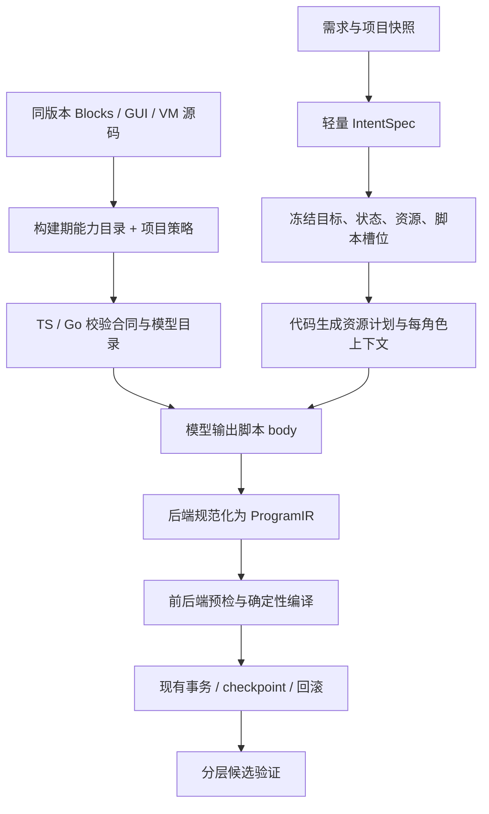

# 基于 Scratch 源码的 AI 写积木流水线设计

状态：设计草案，尚未接入运行时。日期：2026-10-15。本文补充现有实施方案，不声明已经替代现行协议。

适用基线：本项目安装的 `@scratch/scratch-gui 15.1.1`、`@scratch/scratch-vm 15.1.1`、`scratch-blocks 2.1.19`、`blockly 12.5.1`。后续升级必须重新生成能力目录并验证差异。

## 1. 设计结论

采用 **Scratch 源码生成能力目录 → 一次轻量任务接口规划 → 冻结脚本槽位 → 模型生成紧凑 JSON 脚本体 → 代码规范化为 ProgramIR → 既有编译与事务提交**。

第一版不新增英文积木 DSL，不要求模型输出 VM ID、parent/next、shadow、mutation、布局、哈希或下游重复清单。保留原生 opcode 和具名端口，减少格式转换与目录学习成本。

这套方案分别处理两个问题：减少模型必须填写的内容以降低成本；从同版本源码生成可验证合同以减少目录漂移。它不假定“换一种语法即可解决语义错误”，也不承诺没有实测依据的节省比例。



## 2. 源码核查与已完成实验

以下是当前依赖的实测，不是对完整新流水线的上线验证。

| 核查项 | 结果 | 设计含义 |
| --- | --- | --- |
| 新 Runtime 的执行目录 | 139 个 primitive、9 个 hat；`getBlocksJSON()` 为 `[]` | 核心积木和扩展的目录来源不同，不能只调用一个接口 |
| 注册临时探测扩展后 | `getBlocksJSON()` 只返回该扩展的 block JSON | 该接口用于动态／扩展部分 |
| scratch-blocks 注册表 | 171 个类型，含 shadow、菜单、过程及兼容块 | 不等于 171 个模型可用积木 |
| 裸 `motion_movesteps` 实例 | STEPS connection check 为 null，未附 shadow | 不能仅按连接检查推断数值类型或默认值 |
| GUI 工具箱中的 move | 有 `math_number.NUM=10` shadow；舞台工具箱无运动分类积木 | 需合并 GUI 工具箱信息；UI 可见性与执行能力仍需区分 |
| if-else 实例 | Boolean CONDITION，两个具名子栈 | 可直接提取控制结构合同 |
| 变量菜单 | 混有变量选项和 Rename/Delete 命令 | 必须区分数据与界面操作 |
| `control_stop` | all / this script 无 next；other scripts 有 next | 积木形状可能随字段值变化 |
| 最小真实执行 | 绿旗 → repeat 3 → move 10，最终 x=30 | 无渲染行为验证可做，但 tick 不等于一条积木或一次循环 |
| 碰撞验证 | 无 renderer 时明确 SKIPPED | 无渲染器返回 false 不能作为碰撞玩法通过的证据 |
| 当前前后端序列合同 | TS validateProgramIR 接受 cap 后接积木；Go 有 cap 必须在末尾的检查 | 同源目录还需生成或统一序列规则，不能只对齐 opcode 清单 |

证据与复现命令见 [实验说明](../evidence/ai-blocks-source-design/README.md)。额外的紧凑 JSON 规范化实验用于验证能否接入现有编译器，不能证明真实模型的成功率或 Token 收益。

## 3. 能力目录：由三个源码层合并生成

### 3.1 三类事实与一层项目策略

| 来源 | 提取内容 | 不能直接推出的内容 |
| --- | --- | --- |
| scratch-blocks 的实际积木实例与定义 AST | opcode、连接形状、fields、inputs、statement 槽、布尔连接、静态菜单、mutation 变体、消息 key 与源码位置 | 完整执行语义、项目允许范围、所有动态变体 |
| scratch-gui 的 blocks 接线、toolbox、变量／过程 flyout | shadow opcode/field/default、动态菜单 provider、舞台／角色工具箱差异、显示名与序列化值 | 工具箱不可见不一定代表 VM 不能执行；默认值不等于缺参数时可自动补值 |
| scratch-vm 的 primitives/hats、扩展信息、SB3 序列化 | 执行函数存在性、hat 元数据、特殊 shadow 编码、广播和过程接口、资源依赖 | 无法从任意 JavaScript 函数自动证明完整语义 |
| 人工审查的 policy overlay | 模型允许 opcode、扩展权限、当前编译器覆盖、目标限制、状态／素材引用类别、动态菜单 provider、测试能力、特殊变体 | 不复制能从源码可靠生成的 fields/inputs 清单 |

`getPrimitives()` 与 `getHats()` 需分别检查：绿旗等 hat 可以没有 primitive。菜单、shadow、过程 prototype 也不能因没有普通 primitive 就判为非法。

AST 只负责定位和提取可确定的声明，不能静态求值任意 JS。实例探测负责观察初始化后的真实连接，变体 fixture 负责覆盖字段和 mutation 改变形状的情况。无法提取的规则进入明确的未支持清单，不能猜测。

### 3.2 构建期流程

1. 锁定 lockfile、包版本、相关源文件内容哈希，以及 overlay 版本。
2. 在独立探测进程／浏览器页建立 DOM，加载同版本 scratch-blocks，设置固定 locale，完成 GUI 到 VM 的接线。
3. 使用真实 `WorkspaceSvg` 创建积木，观察 `jsonInit` 和最终连接；不能假设裸 headless Workspace 支持所有字段。
4. 分别生成舞台与角色工具箱，并运行变量、过程等动态分类回调，采集 shadow。
5. 使用目标、变量／列表、素材、过程签名 fixtures 探测动态菜单与形状变体。临时 fixture ID 不进入最终目录。
6. 合并 VM primitive/hat 和允许扩展的定义。扩展的目标过滤还需检查 XML／filter 信息，不能只看 JSON。
7. 合并 overlay，按固定顺序输出唯一 `scratch-capabilities.json`。清除随机 ID、翻译显示值和 fixture 资产，计算 catalog hash。
8. 从同一产物生成 TS 目录、Go 目录、端口 schema、模型可见目录，以及合同一致性 fixtures；同时统一 hat 位置、cap 终止、引用作用域等序列规则。生成器保存在仓库内，不再依赖已经移除的 Python 参考文件。

正式 CI 优先使用 Chromium 探测，复用真实 GUI 环境。本次 JSDOM 实验已证明局部提取可行，但不作为所有 SVG、动态分类和扩展都已兼容的承诺。

### 3.3 目录需分开保存的概念

一个端口至少保留 `connectionCheck`、`defaultShadow`、`authoringLiteralKind`、`referenceProvider` 四类信息。

源码中的 native shadow 与当前编译器实际使用的 shadow 也分别记录。两者不同时先验证是否属于允许的等价表示，不把“与 GUI 默认值不同”一律判错，也不未经验证自动覆盖编译策略。例如 GUI repeat 默认是 math_whole_number，当前编译器可以生成 math_number。

例如 `data_setvariableto.VALUE` 的原生连接不限普通 reporter，GUI 默认 shadow 为 text，VM 直接存入参数值；当前项目 ProgramIR 却要求 text literal 的 value 是字符串。这是三个不同层次。第一版遵守现有 ProgramIR 的支持子集，不能把它写成 Scratch 原生的全部类型规则。

动态菜单记录 provider，如 `sprites_except_self`、`clone_targets`、`variables_in_scope`、`costumes_of_target`。请求时用冻结的项目快照生成有效选项。Rename/Delete/Record 等菜单命令不提供给模型。保留 `_mouse_` 等序列化值与可读解释；模型也可使用受控的 `{"builtin":"mouse"}`，由代码映射到指定端口的合法值。

第一版继续将当前编译器不能完整表达的变体标为 unsupported。例如当前目录把 stop 固定视为 cap，不能仅修改目录就开放“停止其他脚本后继续执行”；需同步修改编译／校验合同并通过往返测试。已有程序中的合法变体不应被新生成策略错误改写。

## 4. 任务规划：保留接口，去掉完整动作树

### 4.1 IntentSpec 只规划无法由代码确定的决策

模型保留：目标角色的选择或新增意图、状态及初值、广播接口、脚本触发器与目的、资源需求、扩展需求、用户成功标准与必要假设。

不再要求生成完整 ActionSpec，再把同一动作翻译成积木。脚本目的可用短摘要，但以下关系必须显式声明：

| 对象 | 必须明确的内容 |
| --- | --- |
| 状态 | kind、scope、本地 owner、new/reuse、初值或保留现值策略 |
| 广播 | 每脚本 emits/receives；允许复用现有项目接口，不能要求新生成部分一定同时有收发双方 |
| 脚本槽位 | owner、trigger、purpose、允许读写、允许资源、编辑模式及授权 edit_ref |
| 资源 | owner、kind、purpose、检索词、来源限制、复用／新增、必要尺寸或造型数量；缺信息时使用已记录的产品默认值或追问 |
| 扩展 | 显式需要哪些能力，是否符合用户许可和当前运行时支持 |
| 验收 | 需要满足的结果；只支持已实现的测试模板，其余标 manual／unsupported |

现有对象在请求中由代码分配逻辑 handle；新对象可在单次 IntentSpec 中声明局部 key。验证后统一生成冻结符号表，后续模型只引用给定 handle。handle 不从可修改的中文名字重新生成，类型、作用域和 owner 属于身份约束。模型仍需正确引用逻辑符号，但不需要复述跨阶段哈希和 VM ID。

### 4.2 冻结边界

冻结产物包含 `targets`、`states`、`assets`、`script_slots`、`procedure_signatures`、扩展权限、模式、快照与契约版本。所有 hash 由代码生成，保存在请求／持久化 envelope 中，模型无需输出。

代码据此派生资源准备计划、共享／本地状态安装计划、每角色工作项、展示 Plan 和提交计划。资源匹配与用户确认沿用现有流程；资源准备器不能被误称为现成的 asset_needs → resource_ops 转换器。

如果素材离线准备结果改变可用造型、声音或预期名称，先冻结 `resolved_resources` 的新版本，再生成相关角色脚本。此时只做检索、下载、生成文件、解析元数据和虚拟安装计划；真实 VM 中的资源／状态安装仍在 checkpoint 后的提交事务内完成。安装时通过逻辑绑定解析真实名称；无法保持冻结接口时使受影响版本失效，不能提前修改项目。互不依赖的脚本可在接口冻结后并发，首版沿用现有并发上限。

### 4.3 两类依赖分开

生成调度图表达声明与资源何时可用；运行时接口图表达广播、状态读写和过程调用。广播互相发送可以是合法玩法，不作为生成 DAG 的环错误。源码和项目策略允许的单向广播也不因缺少新建的另一端被一律拒绝。

需要新状态、广播、helper 脚本或过程签名时，走独立的 `contract_revision` 请求：验证增量 → 形成新冻结版本 → 使受影响的脚本失效并重生成。不得从脚本体偷偷扩展接口，也不得自动删掉冲突的广播边。

## 5. 模型输出：紧凑、具名的脚本 JSON

### 5.1 脚本槽位与输出边界

一个槽位对应一个事件帽子脚本；规划阶段负责拆分初始化、循环、按键、广播等事件。过程使用独立 procedure slot。

服务端保存槽位的 owner、触发器、purpose、编辑权限与版本；正常生成只由模型填写 `slot_id` 与 `body`，传输层另有完成／请求修订控制信封，见 5.4。hat 由触发器映射插入，不允许模型在 body 中更换触发器。一个角色可批量返回多个槽位，但每个槽位独立验证和修复；角色数量、脚本数和可见积木预算按最终 ProgramIR 合计计算。

内部脚本结果示例（省略传输控制信封）：服务端已冻结 init 槽位为绿旗事件，`score` 是已声明的全局变量。

```json
{
  "slot_id": "init",
  "body": [
    {
      "opcode": "data_setvariableto",
      "fields": {"VARIABLE": {"state": "score"}},
      "inputs": {"VALUE": "0"}
    },
    {"opcode": "motion_movesteps", "inputs": {"STEPS": 10}}
  ]
}
```

这里使用 `VALUE:"0"` 是为了遵守现有 ProgramIR text literal 合同，不声称将数字 0 自动转成字符串完全无损。若希望支持更完整的 Scratch literal 语义，应另行升级 LiteralIR 并验证类型、shadow 和保存载入。

### 5.2 规范化规则

| 模型内容 | 代码转换 |
| --- | --- |
| 数字／字符串字面量 | 按端口的 authoring literal 合同补 `{kind,value}`；不做隐式字符串与数字互转 |
| input 中嵌套原生积木 | 补 `{kind:"block",block:…}`，继续核对 reporter／Boolean 形状 |
| field 中 `{"state":"score"}` | 校验作用域与访问权限，再转换为该字段要求的 `state_ref` |
| 普通 input 中变量引用 | 转成嵌套 `data_variable` reporter；不能直接把 state_ref 塞入现有 InputIR |
| `{"asset":"…"}`／`{"target":"…"}` | 查冻结绑定，明确转换为 resource_ref 或 existing_asset_ref，并核对端口资源类型 |
| `{"builtin":"mouse"}` | 只在该菜单允许时转换为 `_mouse_`；其他 builtin 同理 |
| `substacks` | 保留 SUBSTACK／SUBSTACK2 具名数组，递归转换 |
| 缺失的可选空容器 | 内部按既有 IR 默认值处理；不补任何有语义的必填输入 |
| metadata、布局、ID、删除列表、状态声明 | 由冻结契约和提交计划填写，模型不输出 |

保留完整 opcode、fields、inputs、substacks 名称，不引入单字母 opcode、位置参数或逐节点 ID。紧凑树仍有嵌套；先依靠较小输出、结构化解码、脚本级边界和明确错误修复。如果实测仍表明深层括号是主要成本，再比较浅层节点表或 DSL，避免提前引入引用图错误。

生产解析与规范化必须先限制响应字节数、JSON 嵌套深度和重复 key；遍历时累计槽位数、节点数和语义深度，达到预算立即失败，不能先无限递归展开再依赖 ProgramIR 的事后检查。演示脚本只验证小样例，未实现这一整套前置保护。

### 5.3 广播、过程与布尔的特殊处理

当前广播接收帽子的 `BROADCAST_OPTION` 是可解析 state_ref 的 field；发送积木的 `BROADCAST_INPUT` 是 text input。兼容阶段，发送的逻辑广播 handle 只能在**舞台广播唯一、安装后的 ID/name 与冻结绑定一致**时转换为规范名称；发现重名或重命名即失败，不能沿用 `.find` 的首项匹配。

后续如需稳定支持广播重命名，独立升级 ProgramIR 输入引用协议，让广播菜单通过 `resolver.state` 解析实际 ID/name。不能把这一能力描述成当前编译器已经支持。

Boolean 输入第一版只接受显式 Boolean reporter，不把 `true`、`"true"`、null 自动改成任意条件。变量、列表和过程参数重名时使用带 owner／scope 的 handle，不能靠名字优先级猜测。已有合法名称与积木显示文案相同也无需禁止。

自定义积木的签名、参数类型、默认值和 warp 由 procedure slot 管理；模型写 body 与受控调用，编译器拥有 mutation 和真实参数 ID。当前前后端过程合同尚需对齐，未通过专项回归前此类请求继续走原路径或明确提示不支持，不能静默丢掉定义／调用。

### 5.4 JSON Schema 与传输

从能力目录和当前 opcode profile 生成 opcode 分支 schema，约束具名 fields/inputs/substacks；引用只可选冻结符号。按服务商实测能力使用严格 schema、JSON object 或现有标签封装，每次请求只采用一种协议。

传输信封采用一个固定 object：`slot_id`、`status`、`body`、`revision`。`status=ready` 时 body 为脚本体、revision 为 null；`status=needs_revision` 时 body 为 null，revision 描述缺失的能力或接口。两分支之间的条件由代码复验，不依赖供应商支持根级 oneOf。示例：

```json
{
  "slot_id": "move_and_check",
  "status": "needs_revision",
  "body": null,
  "revision": {
    "reason": "missing_capability",
    "requested_opcodes": ["sensing_keypressed"],
    "explanation": "需要检测按键是否持续按下"
  }
}
```

revision 使用小型独立 schema；reason 为受控枚举，requested_opcodes 为有长度上限的名称数组。新状态／脚本／过程需求进入同一受控规划修订通道。服务端核对能力存在性、产品允许范围、用户授权和变更预算后才更新 profile／接口版本；扩大 profile 不扩大扩展权限。严格 schema 下模型无法输出目录外 opcode，应使用此分支；`CAPABILITY_NOT_IN_PROFILE` 主要用于非严格响应、过时 profile 或内部验证差异。

内部 AuthoringIR 允许省略空字段；严格 schema 方言可能要求所有属性出现。适配层可把不使用的可选容器编码为空对象／数组或明确的 nullable 字段，再还原内部结构。不能假定“strict”和“全部字段都省略”在所有供应商上同时可行。schema 编译失败不得无提示降级成无约束输出。

普通生成使用小批次槽位，错误时只替换失败槽位；语法无法解析整个响应时，不承诺一定能从中可靠提取合法脚本。只有独立成帧、完整解析并验证的槽位才可保留。不得根据流式半截 JSON 提前提交。

## 6. 上下文与修复预算

program 请求只包含当前角色的槽位目的、触发器、状态访问、广播接口、相关资源、受控脚本引用、opcode profile 和必要约束。完整 IntentSpec、资源清单、哈希和其他角色实现保留在服务端校验，不逐角色重发整份 requirements/task_spec/blueprint/plan/manifest。

append 可裁剪既有脚本全文，但仍保留状态类型／作用域、广播接口和必要的已有行为摘要；modify 带授权脚本全文；rewrite 带受影响的可编辑脚本及保护摘要。不能把所有模式都裁成只有名字。

目录选择用短小类别和依赖闭包，固定包含必要控制／运算基础项。未选中的合法 opcode 返回 `CAPABILITY_NOT_IN_PROFILE`，允许在明确扩展 profile 后重试；策略禁止和目录不存在使用不同错误码，不能近似改成另一个积木。

提示词顺序：稳定协议和类别目录 → 稳定项目／角色接口 → 动态需求、目标脚本与错误信息。按 profile 记录前缀缓存收益；本地字符串组装缓存与服务商 cache token 分开统计。

修复分级：L0 仅规范无语义差异的围栏、BOM、传输空白及明确默认容器；L1 对失败槽位整段重写；L2 才重生成该角色，仍失败则保留已验证结果并报告。截断、取消和供应商未完成输出不能靠补括号变成成功。

每次修复带 `slot_id`、输入版本和服务端校验的 artifact hash，拒绝过时响应。合并后重新验证整个角色及项目接口。所有槽位共享 run 级调用数、Token、墙钟、并发和契约修订预算；初始建议每槽位最多 1 次 L1、每角色最多 1 次 L2，最终按基线校准，不能把“每脚本两次”无上限相加。

接口通过也不能排除跨脚本时序回归，例如多个绿旗脚本、共享变量和 broadcast-and-wait 的相互影响。已有受控行为测试时，局部修复后重跑受影响的交互测试，最终按项目级 must 集合验收；没有相应 oracle 时明确保持未验证，不能用单槽位通过推断整项目正确。

## 7. 验证：分别报告能证明什么

| 层级 | 检查 | 结果能证明什么 |
| --- | --- | --- |
| V0 静态与编译 | 源码目录合同、接口权限、ProgramIR 预检、编译后连接图、必需引用、过程签名和 mutation | 结构及已声明合同一致 |
| V1 VM 往返 | 新 VM A 载入候选 → 导出 SB3 → 新 VM B 再载入；规范化比较关键图、状态和资源 | 能被真实 VM 载入、保存、再载入，关键结构未丢失 |
| V2 受控行为 | 绿旗初始化、有限 repeat、按键、变量、广播、过程等有明确预期的测试 | 仅执行过的场景满足断言 |
| V3 渲染／人工 | 真实 renderer 下的碰撞、颜色和点击；音效／语音等能力单独验证或人工确认 | 相应场景的图形、输入和资源表现 |

每项结果采用 PASS／FAIL／SKIPPED／TIMEOUT，并记录能力、预算和 VM/catalog 版本。SKIPPED 不计入通过率；must 测试不能以 SKIPPED 获准自动通过。UI 应说明实际验证范围，不能把 V0 通过称为“玩法已验证”。

V1 比较规范化图与引用，不比较 ZIP 字节、随机 shadow ID 或项目导出的临时字段。VM 可能修复 shadow，差异应记录并检查是否保留语义，而不是只看 load 是否抛错。仅检查 JS 属性或 `Blocks.createBlock` 成功不等于 VM 验证通过。

V2 先从无需渲染的短测试开始。键盘使用 VM 的 IO 注入，同时验证帽子与持续按键状态；一个 tick 不等于一个循环。计时、glide 和调度预算使用不同时间来源，不能只改一个时钟就称确定性。随机测试在隔离域中控制玩法随机源，避免与 ID 生成混用。

行为 oracle 来自用户成功标准、审查过的测试模板或人工评测，不从刚生成的积木反推“它应该这样运行”来循环证明自己。复杂自然语言验收不得伪装成确定性代码推导。

执行环境有 tick、primitive 次数、克隆、内存和墙钟上限。优先验证独立 Worker bundle；涉及渲染使用隔离浏览器页／Playwright。同步死循环需要父进程／Worker 终止能力，单线程 Promise 超时不能抢占。加载前检查扩展、资源来源和宿主回调策略，复用当前项目权限，不开放任意扩展执行。

本地默认 VM Node bundle 的 stylesheet 路径有缺失，本次实验直接使用包内 Runtime 源码；完整 VM 载入、Worker、音频和 WebGL 构建仍属待实施验证项，不据此承诺开箱可用。

## 8. 编辑保护、提交和持久化

继续保留现有快照检查、事务锁、checkpoint、预检和补偿／回滚。生成期间切换编辑器选中角色不必强制取消：提交仍绑定原目标；目标删除、代码／状态变化或加载新项目才使快照失效。

这里的事务由宿主应用的完整 SB3 备份、锁和恢复实现，不是 Scratch VM 原生 ACID 事务。行为验证只在隔离 VM 中执行，不启动用户当前项目；验证结束或失败后停止并释放 VM、Worker、渲染／音频等资源。恢复测试包含“故障后再次生成／运行”，检查线程、克隆及宿主监听没有污染下一次任务，不能只检查项目对象已还原。

append 不删除脚本；modify 只替换授权 edit_ref；rewrite 只处理当前可编辑脚本，保留受保护的现有脚本。`script_1` 是一次快照内的别名，edit_ref 必须与 base_snapshot_hash 绑定；恢复或重试不能用新快照重新解释旧别名。

定义新的外层 artifact envelope，固定 `pipeline_version`、`authoring_ir_version`、`catalog_hash`、`normalizer_version`、快照 hash、冻结接口版本及 source/normalized artifact。已有 Blueprint/Manifest/ProgramIR 的 schema_version 不被随意改写，也不把 derived_by 塞入拒绝未知字段的旧对象。

旧 run 继续用旧 decoder、hash 和恢复流程。新 run 走明确的新分支；部署保留所有仍可恢复版本所需的适配器和目录快照，直到相应恢复保留期结束。不能用新 normalizer 静默重解释旧草稿；缺少必要版本时明确失败并保留原始产物供恢复。

第一阶段只在旧 TaskSpec 验证后派生展示 Plan 和可确定投影；引入 IntentSpec 时同步新增持久化、程序请求和接口验证分支。既有 durable 流程强制解析旧 TaskSpec，不能声称换个 SlimSpec 名字就能无缝复用全部链路。

## 9. 实施阶段与退出条件

| 阶段 | 具体交付 | 退出条件 |
| --- | --- | --- |
| P0 源码与基线 | 固定版本；修复过时合同测试和测试环境；源码探测；补全 Token/错误/重试统计；复用已有评测题集 | 可重现的目录报告和生成基线；失败能定位到层级 |
| P1 单一目录与减重 | 目录生成器、overlay、TS/Go 同源生成；展示 Plan 代码生成；每角色上下文切片；清理提示词矛盾 | 所有现有允许 opcode 有来源与覆盖；前后端合同一致；质量无显著回退 |
| P2 紧凑脚本体 | AuthoringIR normalizer、冻结 slot、严格输出能力探测、单角色 append 灰度、槽位级修复；最小 artifact envelope、catalog/normalizer 版本固定与槽位恢复策略 | 真模型对照中成功任务成本下降；功能正确率和 P95 无明显回退；中断恢复不重解释旧槽位 |
| P3 任务与资源派生 | IntentSpec、符号表、资源计划、接口变更、项目并发，扩展持久化新旧契约分支 | 多角色、资源、广播和恢复场景等价；无名称／引用错绑 |
| P4 验证与编辑扩大 | V1 往返、受控行为集；modify/rewrite 与过程专项合同 | 必须验证项通过；恢复、回滚、修改保真度满足评测门槛 |

V1 的构建试验可从 P0 并行开始，不能等大规模改协议后才发现验证环境不可用。已有提交保护从 P0 起持续保留，不是 P4 才补。

单角色快速路径仅在“现有角色 append、无新状态／资源／扩展／接口、触发器可明确识别”时跳过规划模型调用，直接构建槽位并生成 body；不明确时回到轻量规划。项目模式通常是一次规划加按角色生成，角色内多个槽位可批量，不能宣称所有需求固定只需两次调用。

## 10. 评测与验收口径

先比较 A：现行链路；B：同源目录＋上下文减重＋现有 ProgramIR；C：B＋紧凑 AuthoringIR＋局部修复。保持模型、思考档位、题集、采样次数和预算可比；分别记录每项优化的贡献。

成本同时记录原始 input/output、cached input、reasoning 和实际计费口径。推理 token 若已计入 output，不重复相加。每成功任务成本包括同一批任务的失败、修复和重生成消耗，并同时报告成功率，避免只挑成功样本。

质量至少包含：首轮语法／形状／引用通过率、整次任务完成率、结构与 VM 往返通过率、已执行 must 行为通过率、未验证比例、修改保真度、回滚／恢复结果和用户撤销率。不能只用“能编译”替代功能正确率。

题集覆盖：同名不同作用域状态、已有变量名等于积木文案、广播循环与复用已有消费者、嵌套 Boolean、stop 字段变体、动态菜单、资源落地重命名、过程参数、长脚本、编辑期间切项目、旧 run 恢复。原有 30–50 题可作为试验起点，重复采样并报告不确定性，不据此宣称错误率为零。

纯解析／规范化／目录生成使用确定性 CI 闸门；付费且随机的真实模型评测放受控发布／定期评测任务，并固定比较基线。发布前先修复当前已存在的 sessionStorage 测试环境、旧 Python 目录引用和扩展断言问题。

## 11. 源码依据与接入位置

以下路径对应当前安装包；可复现脚本记录包版本，生成目录时另保存源文件 hash。它们不代表上游最新版本。

| 依据 | 位置 |
| --- | --- |
| 核心执行／hat 注册与扩展 JSON | [runtime.js](../../frontend/node_modules/@scratch/scratch-vm/src/engine/runtime.js)，L773、L838、L1442 |
| 实例形状与变量字段要求 | [index.ts](../../frontend/node_modules/scratch-blocks/src/index.ts)，L94；[control.ts](../../frontend/node_modules/scratch-blocks/src/blocks/control.ts)，L157；[scratch_field_variable.ts](../../frontend/node_modules/scratch-blocks/src/fields/scratch_field_variable.ts)，L32、L97 |
| 工具箱 shadow 与动态菜单 | [make-toolbox-xml.js](../../frontend/node_modules/@scratch/scratch-gui/src/lib/make-toolbox-xml.js)，L26；[blocks.js](../../frontend/node_modules/@scratch/scratch-gui/src/lib/blocks.js)，L106、L171；[data_category.ts](../../frontend/node_modules/scratch-blocks/src/data_category.ts)，L99 |
| 数据值、类型转换与广播执行 | [scratch3_data.js](../../frontend/node_modules/@scratch/scratch-vm/src/blocks/scratch3_data.js)，L44；[cast.js](../../frontend/node_modules/@scratch/scratch-vm/src/util/cast.js)，L22、L49、L121；[execute.js](../../frontend/node_modules/@scratch/scratch-vm/src/engine/execute.js)，L318 |
| 碰撞与渲染依赖 | [rendered-target.js](../../frontend/node_modules/@scratch/scratch-vm/src/sprites/rendered-target.js)，L819 |
| 过程调用与序列化 | [scratch3_procedures.js](../../frontend/node_modules/@scratch/scratch-vm/src/blocks/scratch3_procedures.js)，L27；[sb3.js](../../frontend/node_modules/@scratch/scratch-vm/src/serialization/sb3.js)，L38、L683 |
| 现有 literal、shadow、mutation 编译 | [program-compiler.ts](../../frontend/src/ai-blocks/program-compiler.ts)，L82、L551、L569、L597 |
| 当前 IR、预检与目录 | [program-ir.ts](../../frontend/src/ai-blocks/program-ir.ts)，L1、L53；[program-preflight.ts](../../frontend/src/ai-blocks/program-preflight.ts)，L16；[block-catalog.ts](../../frontend/src/ai-blocks/block-catalog.ts)，L7 |
| 上下文减重落点 | [orchestrator.go](../../backend-go/internal/orchestration/orchestrator.go)，L1289 |
| 新旧 run 契约分支 | [execute.go](../../backend-go/internal/runmanager/execute.go)，L191、L595；[decode.go](../../backend-go/internal/schema/decode.go)，L29 |
| 编辑快照与候选验证落点 | [target-context.ts](../../frontend/src/ai-blocks/target-context.ts)，L158、L237；[generation-runner.ts](../../frontend/src/ai-blocks/generation-runner.ts)，L384、L687、L823；[verification-service.ts](../../frontend/src/ai-blocks/verification-service.ts)，L215 |

上游背景：[Scratch Blocks 官方源码](https://github.com/scratchfoundation/scratch-blocks)明确区分可视积木定义与 VM 执行；本文的接口和实验以本地锁定版本为准。
